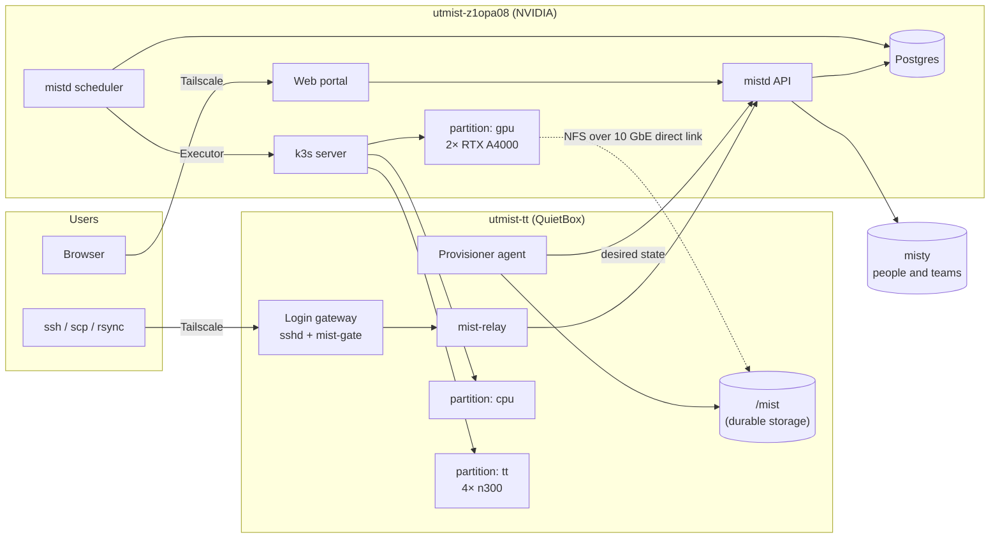
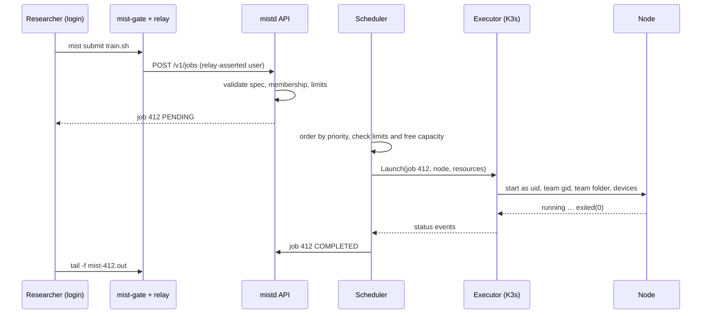

# Mist architecture

Mist is UTMIST's research compute platform. It works like the batch systems on
national HPC clusters. Each researcher gets a folder inside each of their team
folders and moves files with `scp`/`rsync`. Code runs as **jobs**: batch scripts
or short interactive shells. A scheduler places jobs on the GPU, CPU and
Tenstorrent hardware. Each job runs as the researcher's own Linux user, in their
own folder. Researchers never write Dockerfiles or declare mounts.

This document is the system overview and the coordination point between
component owners. Each component has a document with the contracts it must
honour. The reasons behind major choices are in the
[decision log](docs/agents/architecture/decisions.md).

> **Status:** target design, agreed October 2026. This design replaces the
> platform described in `docs/content/` (container-image jobs, dataset and
> result pools, team namespaces). It starts fresh: no users or data are migrated.

## Goals

1. **Development feels like a workstation.** A researcher sets up a Python
   environment once, in their own folder, and every job uses it. Files a job
   writes are simply there afterwards.
2. **Access follows teams.** Teammates can read each other's work. Other teams
   cannot see it at all. Some projects are under IP agreements, so this boundary
   is a hard requirement.
3. **Code runs only inside jobs.** Login sessions move files and manage jobs.
   Compute and accelerators are reached only through a scheduled job.
4. **Adding a node is cheap.** Adding a third or fourth machine means configuring
   that node, not redesigning the system.
5. **The A4000 GPUs come first.** The NVIDIA partition ships first; Tenstorrent
   follows on the same design.

## System at a glance



## Components

| Component | Responsibility | Document | Proposed owner |
|---|---|---|---|
| Identity and accounts | People and teams from misty; Mist accounts, UIDs, GIDs, SSH keys; sign-up; provisioning Linux accounts and folders | [identity-and-accounts.md](docs/agents/architecture/identity-and-accounts.md) | Lucas |
| Storage | `/mist` layout and permissions, NFS, volumes, usage reporting, quotas, scratch, backups | [storage.md](docs/agents/architecture/storage.md) | Ansh |
| Login gateway | Restricted SSH (file transfer and `mist` commands only), identity relay, the `mist` CLI | [login-gateway.md](docs/agents/architecture/login-gateway.md) | TBD |
| API | The one HTTP API used by the portal, CLI and agents; authentication and authorization | [api.md](docs/agents/architecture/api.md) | Shared; each owner defines their endpoints |
| Scheduler | Partitions, QoS, limits, queue, priority, fairshare, placement, accounting | [scheduler.md](docs/agents/architecture/scheduler.md) | Brandon |
| Executors | Run an admitted job on a node; stream I/O; report status. K3s executor first, native node executor later | [executors.md](docs/agents/architecture/executors.md) | Brandon |
| Runtime environment | What a job sees: images, software, environment variables, caches, outputs, signals | [runtime-environment.md](docs/agents/architecture/runtime-environment.md) | Scott (to confirm) |
| Web portal | Lightweight UI over the API: account, SSH keys, teams, jobs, queue, usage, admin | [portal.md](docs/agents/architecture/portal.md) | Andrei |
| Deployment and network | Hosts, network paths, services, secrets, admin access, adding nodes | [deployment-and-network.md](docs/agents/architecture/deployment-and-network.md) | Ethan, with Ansh |

Owners should confirm or reassign rows here.

## Core concepts

- **Person.** A human registered in misty. Misty is the source of truth for
  people, teams and membership.
- **Account.** A person's Mist identity: one immutable `username`, one stable
  Linux UID, and SSH keys. It is created when a registered person signs up.
- **Team.** A misty team. On Mist, each team has a Linux group (`team-<slug>`) and
  a folder `/mist/teams/<slug>/`.
- **Partition.** A named pool of nodes that share one kind of hardware: `gpu`
  (NVIDIA), `cpu` (CPU-only, used for data prep and downloads) and `tt`
  (Tenstorrent). A job targets exactly one partition.
- **QoS.** A class of service, `normal` or `interactive`, carrying limits and a
  priority weight.
- **Job.** A request to run a script (batch) or a shell (interactive). It names
  one partition, one QoS, one **charged team**, its resources and a time limit.
  It runs as the submitter's UID. Accelerators are allocated whole and one at a
  time: two 1-GPU jobs run side by side on the A4000 box.
- **Charged team.** The team a job is billed to and scoped to. The job sees only
  that team's folder and the shared software. It cannot see the submitter's other
  teams.
- **Volume.** One durable storage location, an NFS export on one server. Each
  team folder lives entirely on one volume. There is one volume today.

## Key flows

### Sign-up and first login

1. A person signs in to the portal. Identity confirms with misty that they are
   registered and loads their teams.
2. Mist creates their account: it reserves a username and a UID and records team
   memberships.
3. The person adds an SSH public key in the portal.
4. The provisioner agent on the storage/login host reconciles the change. It
   creates the Linux user and groups, and `/mist/teams/<team>/<user>/` for each
   team.
5. The person runs `ssh <user>@<login host>`. They land in a folder with one
   entry per team.

### Moving files

`scp`, `rsync` and `sftp` go through the login gateway, which sits on the storage
host and writes straight to disk. Unix permissions decide what each person can
read and write.

Downloads from the internet (Hugging Face, S3, Kaggle and so on) run as jobs on
the `cpu` partition, using `mist run -p cpu -- <command>` or `mist shell -p cpu`.

### Batch job



The job starts in the folder it was submitted from. Its output streams to
`mist-<id>.out` there. Checkpoints and results go wherever the code writes them,
in `/mist` by default.

### Interactive job

`mist shell --gpus 1` submits a job with QoS `interactive`. When the job starts,
the API attaches the researcher's terminal to a shell inside it. The job ends
when the shell exits. If the connection drops, the job waits for a grace period
so the researcher can run `mist attach`, then it is cancelled. A browser terminal
will later reuse the same attach endpoint.

## Data ownership

Postgres on the control node is the single source of truth for Mist state.
Kubernetes objects, Linux accounts and folders are *derived* state: agents
reconcile them from the database.

| Data | Authority | Owner |
|---|---|---|
| People, teams, membership | misty (cached in Mist) | Identity |
| Accounts, UIDs, GIDs, SSH keys | Mist DB | Identity |
| Linux users, groups, folders | Derived by the provisioner | Identity, Storage |
| Volumes, team placement, usage | Mist DB | Storage |
| Partitions, QoS, limits | Mist DB (admin-configured) | Scheduler |
| Jobs, job events, usage records | Mist DB | Scheduler |
| Pods and other execution objects | Derived by the executor | Executors |
| Files | `/mist` | Storage |

Each owner owns their tables and migrations. Other components go through that
owner's Go package or API, not their tables.

## Code layout

```text
cmd/mistd/            one binary: `mistd api`, `mistd scheduler`, `mistd provision`
cmd/mist/             CLI (on the login gateway; laptops later)
cmd/mist-gate/        SSH ForceCommand dispatcher
cmd/mist-relay/       login-node identity relay and SSH key lookup
cmd/mist-job-entry/   in-job wrapper: output file, signals, exit reasons
internal/api/         HTTP server, middleware, shared wire types
internal/identity/    accounts, misty client and stub, provisioning state
internal/storage/     layout rules, volumes, usage
internal/scheduler/   queue, policy, placement, accounting
internal/executor/    Executor interface; k3s/ and node/ implementations
internal/db/          connection and migrations (one directory per owner)
images/               job runtime images
deploy/               k3s manifests, systemd units, host setup
web-interface/        portal
```

The existing `src/` and `cli/` modules belong to the platform being replaced.
They are removed once the new path serves jobs.

## Milestones

| Milestone | Outcome |
|---|---|
| **M1: GPU batch** | Sign-up (misty stubbed), SSH login, file transfer, `mist submit/run/jobs/show/logs/cancel` on `gpu` and `cpu`, team isolation, 10 GbE direct link |
| **M2: Interactive** | `mist shell` and `mist attach` with reattach grace; `interactive` QoS |
| **M3: Fair scheduling** | Priority, fairshare by team, backfill, accounting, admin limits, queue views; backups in place |
| **M4: Tenstorrent** | `tt` partition, TT runtime image, board reset between jobs |
| **M5: Native executor and web terminal** | Node executor without containers, behind the same interface; browser terminal; port forwarding into jobs |

Each component document lists its work per milestone.

## Open questions

| Question | Owner |
|---|---|
| Real misty API: shape, and how membership changes reach Mist (polling or webhooks) | Identity |
| How people prove who they are at sign-in (Google or UofT SSO, or email magic link) | Identity |
| Enforced storage quotas: needs `/mist` on a dedicated filesystem with project quotas | Storage |
| Offboarding: what happens to a folder when someone leaves a team or UTMIST | Identity, Storage |
| Backup tool, schedule and retention | Storage |
| Default limits per partition and per user once real usage is known | Scheduler |
| Monitoring and alerting beyond the portal | Deployment |
