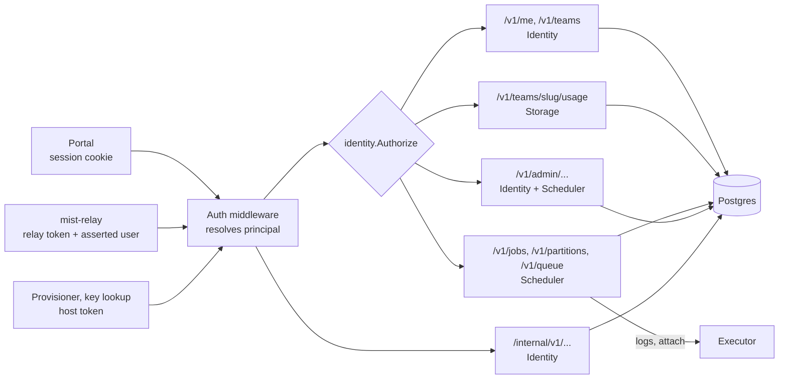

# API

`mistd api` is the only way clients and agents reach Mist state. This document
fixes the conventions every endpoint follows, how callers authenticate, and the
job wire types shared by the CLI, portal and scheduler. Each component document
lists the endpoints it owns. Overview: [ARCHITECTURE.md](../../../ARCHITECTURE.md).

## How it fits

Every request passes the same middleware, then reaches the handlers of the
component that owns it:



## Conventions

- **Format.** JSON over HTTP. Paths are versioned: `/v1/...` for users and
  admins, `/internal/v1/...` for host agents.
- **Placement.** One `mistd api` process on the control node (NVIDIA box). The
  portal's Nginx forwards `/api/*` to it and strips the prefix. Agents reach it
  on the direct link (`192.168.240.1`).
- **Logic lives in the API.** Clients don't compute permissions, defaults or
  states; the API returns ready-to-display fields (for example `pending_reason`
  and `can_cancel`). Clients may poll: every 5–10 s is fine.
- **Errors** use one shape and a stable `code`:

  ```json
  { "error": { "code": "limit_exceeded", "message": "Team vision already has 2 GPUs running", "details": {} } }
  ```

  Codes: `unauthenticated`, `forbidden`, `not_found`, `invalid`,
  `limit_exceeded`, `conflict`, `unavailable`, `internal`.
- **Lists** take `?limit=` and `?cursor=` and return `{ "items": [...], "next_cursor": "..." }`.
- **Times** are RFC 3339 UTC strings. **Durations** are integer seconds.
  **Sizes** are integer bytes.
- **Streams** (log follow, interactive attach) use WebSockets on the same paths
  with `?follow=1` or an `Upgrade` header.

## Authentication

| Caller | Credential | Principal |
|---|---|---|
| Portal | Session cookie set at sign-in | The signed-in account |
| CLI on the login gateway | Relay token + `X-Mist-Asserted-User` (see [login-gateway.md](login-gateway.md)) | The asserted account |
| Provisioner, relay key lookup | Per-host agent token | The host; `/internal/*` only |
| Laptop CLI (later) | Personal API token | The token's account |

One middleware resolves the principal, and authorization goes through
`identity.Authorize` (see [identity-and-accounts.md](identity-and-accounts.md)).
Handlers never read identity headers directly. Check active account and current
membership on every request and stream establishment; revoke existing streams
when the authorization generation changes. The relay cannot assert disabled
accounts. Agent tokens are scoped by host and operation, not interchangeable
administrator credentials.

Production uses HTTPS, `Secure`, `HttpOnly`, `SameSite=Lax` session cookies,
CSRF protection on mutations, and an Origin allowlist for browser WebSockets.
Nginx must strip user-supplied identity headers. Keep dev principal headers out
of production binaries. See Identity for bounded directory freshness/leases.

Authorization matrix: owners may view/cancel their currently authorized jobs and
attach to their own interactive jobs; current team members may view team job
metadata/scripts/logs; team leads may cancel team jobs; admins may view/cancel
all jobs but cannot attach as the user. Former membership or ownership alone
never grants continued team access. Non-team callers receive `not_found` on job
and log endpoints; `/queue` provides only the explicitly public summary.

`POST /v1/jobs` accepts a required `Idempotency-Key` from CLI clients. Store
(account, key, canonical client request hash, job ID, resolved submission spec)
atomically with submission. Look up the key before applying current defaults:
same key/body returns the original job even if defaults changed; differing body
returns `conflict`. Reauthorize access before returning a cached result. Retain keys
for at least the job metadata lifetime. Cancellation is intrinsically idempotent
and returns the current job after recording stop intent; it does not wait for
termination or release resources.

## Endpoint index

| Area | Endpoints | Owner doc |
|---|---|---|
| Account | `GET/PATCH /v1/me`, `/v1/me/ssh-keys` | identity |
| Teams | `GET /v1/teams`, `GET /v1/teams/{slug}` | identity |
| Storage | `GET /v1/teams/{slug}/usage`, `GET /v1/volumes` (admin) | storage |
| Jobs | `POST /v1/jobs`, `GET /v1/jobs`, `GET /v1/jobs/{id}`, `POST /v1/jobs/{id}/cancel`, `GET /v1/jobs/{id}/log`, `GET /v1/jobs/{id}/attach` (WebSocket) | scheduler / executors |
| Cluster | `GET /v1/partitions`, `GET /v1/queue` | scheduler |
| Admin | `/v1/admin/accounts`, `/v1/admin/partitions`, `/v1/admin/qos`, `/v1/admin/limits`, `/v1/admin/nodes` | identity, scheduler |
| Agents | `/internal/v1/provision/*`, `/internal/v1/ssh-keys/{username}` | identity |
| Cleanup | `POST /internal/v1/executions/{execution_id}/cleanup` | executor; node-scoped authenticated receipt |

## Job wire types

### Submitting: `POST /v1/jobs`

```json
{
  "team": "vision",
  "partition": "gpu",
  "qos": "normal",
  "name": "resnet-sweep-3",
  "kind": "batch",
  "script": "#!/bin/bash\n#MIST --gpus=1\npython train.py --lr 3e-4\n",
  "args": [],
  "workdir": "/mist/teams/vision/alice/resnet",
  "output": "mist-%j.out",
  "env": { "WANDB_PROJECT": "resnet" },
  "resources": {
    "cpus": 8,
    "memory_bytes": 34359738368,
    "gpus": 1,
    "tt_boards": 0,
    "scratch_bytes": 107374182400
  },
  "time_limit_seconds": 14400,
  "signal_grace_seconds": 60
}
```

- `kind`:
  - `batch` needs `script`.
  - `command` (from `mist run`) takes `argv` instead of `script`.
  - `interactive` (from `mist shell`) takes neither.
- **The API fills in missing fields** from partition and QoS defaults and
  returns the complete, normalised spec. Defaults live only in the database,
  never in clients.
- **Validation:**
  - The caller must be active and a current member of `team`; directory state
    must be fresh. Admission rechecks this atomically, not just at submission.
  - `workdir` must be inside the charged team. Omitted workdir uses the personal
    home for an explicit team; otherwise derive team from the submitted canonical
    path. Never accept a login landing folder as a job workdir.
  - Resolve relative output under workdir and expand only `%j`. Require output
    inside the charged team's durable tree. Executor revalidates inside the
    restricted mount namespace as the user, handling symlinks/path races without
    privileged traversal. Missing/unwritable paths produce a clear launch error.
  - CPU, memory, scratch and time are positive bounded integers; accelerators
    are nonnegative whole counts. API `cpus` is a whole-core count, converted
    once to executor millicores (1 CPU = 1000 mCPU). Reject overflow and incompatible partition
    resources. Enforce partition/QoS maximums, including signal grace 1–120 s.
  - `gpu` needs GPUs >= 1 and TT boards = 0; `cpu` requires both = 0; `tt` needs
    boards >= 1 and GPUs = 0. A request must fit at least one configured node.
  - `interactive` kind requires interactive QoS; batch/command use normal QoS.
    Users cannot obtain interactive priority for unattached batch jobs.
  - Optional `runtime` selects only an approved retained partition profile;
    resolve it to a digest/profile version at admission and freeze it.
  - Reject unknown/mutually exclusive command fields. Bound script size (1 MiB),
    env total (64 KiB), argument total (128 KiB) and name length (128 characters).
    Preserve batch `args` separately; command uses `argv`, without a shell.
  - User env cannot override identity, allocation, device visibility, internal
    attach socket or timing fields. Runtime documents the protected names.
- **Reply:** `201` with the job object, in state `PENDING`.

### Job object: `GET /v1/jobs/{id}`

```json
{
  "id": 412,
  "name": "resnet-sweep-3",
  "user": "alice",
  "team": "vision",
  "partition": "gpu",
  "qos": "normal",
  "kind": "batch",
  "state": "PENDING",
  "pending_reason": "RESOURCES",
  "pending_detail": "Waiting for 1 GPU; estimated start after job 409 ends",
  "exit_reason": null,
  "exit_code": null,
  "resources": { "cpus": 8, "memory_bytes": 34359738368, "gpus": 1, "tt_boards": 0, "scratch_bytes": 107374182400 },
  "time_limit_seconds": 14400,
  "node": null,
  "workdir": "/mist/teams/vision/alice/resnet",
  "output_path": "/mist/teams/vision/alice/resnet/mist-412.out",
  "submitted_at": "2026-11-02T15:04:05Z",
  "started_at": null,
  "ended_at": null,
  "can_cancel": true,
  "can_attach": false
}
```

**States and reasons** are defined in [scheduler.md](scheduler.md#job-states).
The object also exposes `cleanup_pending`, `cleanup_detail`, `output_incomplete`,
`authorization_generation`, and (interactive only) `attached`, `detached_at`,
`reattach_deadline`. The API computes `can_cancel` and `can_attach` using state
and current authorization. `CLEANING` is nonterminal; a `NODE_FAIL` job may be
terminal with cleanup still pending and capacity quarantined.

Other teams' jobs appear only in `GET /v1/queue` as an allowlisted summary:
job ID, partition, QoS, state, resource counts, age and a public pending-reason
code. Set `user`, `team`, `name`, `workdir` and `output_path` to null. Exclude
scripts, env, arbitrary error text, event actors and detailed pending messages;
redacting a few top-level names does not sanitize embedded paths or secrets.

### Logs: `GET /v1/jobs/{id}/log`

- **Running job:** returns the live output stream from the executor. Add
  `?follow=1` to stream it over a WebSocket.
- **Finished job:** returns the stored tail (last 64 KiB) from the database.
- **The full log normally resides in `/mist`.** Include `output_path` and
  `output_incomplete`. Node failure, OOM/SIGKILL, or storage errors can prevent a
  final footer or file creation; the DB retains the observed outcome and last
  available tail. API log viewing never reads arbitrary user-supplied paths.

### Attach: `GET /v1/jobs/{id}/attach` (WebSocket)

Binary frames carry terminal bytes. Text frames carry control messages:

```jsonl
{ "type": "resize", "cols": 120, "rows": 40 }
{ "type": "signal", "name": "SIGINT" }
{ "type": "exit", "code": 0 }
```

Only the currently authorized job owner can attach, while the interactive job
is `RUNNING`. The holder allows one attachment; a second receives `conflict`.
Network closure detaches, explicit `POST .../cancel` cancels, and shell exit ends
the job. Resize and allowed terminal signals target the existing PTY/foreground
process group; callers cannot specify a PID, executable or alternate command.
The holder owns grace timing, so API restart cannot reset it. The CLI's `mist
shell` and later browser terminal use this same endpoint.

## Implementation notes (M1)

The job endpoints are in `internal/api`. Where this section is more specific than
the contract above, the code follows this section.

- **Status codes.** `unauthenticated` is 401, `forbidden` 403, `not_found` 404,
  `invalid` 400, `limit_exceeded` 422, `conflict` 409 and `unavailable` 503.
  Clients should switch on `code`, not on the status.
- **Authenticators.** `api.Authenticator` resolves a request to an
  `identity.Principal`. It returns `api.ErrNoCredentials` when the request carries
  none of its credentials, so the next one can try. Identity plugs the portal
  session and relay authenticators into `Server.Accounts`. Until it does,
  `mistd api` fails closed: every `/v1` request is `unauthenticated`, and
  authorization is `unavailable`. Session-cookie CSRF and Origin checks belong
  to the session authenticator.
- **Development identity.** `X-Mist-Dev-User` and `mistd -dev-fixture` exist only
  in binaries built with `-tags mistdev`, which use the `identitytest` accounts.
  - Production binaries contain neither, refuse `-dev-fixture`, and answer
    `unauthenticated` to any request carrying the header, even alongside valid
    credentials.
  - `cmd/mistd/nodev_test.go` checks this on the built server.
- **Idempotency.** `Idempotency-Key` is required from every caller, not only the
  CLI. The portal should send a fresh `crypto.randomUUID()` per submit click.
  - Keys are per account.
  - The hash covers the request as decoded: field order and spacing don't
    matter.
  - A replay answers `200` with header `Idempotent-Replayed: true` (a new job is
    `201`), after rechecking that the caller may still view the job.
  - The key is checked once before normalization and again inside the submit
    transaction, under the per-user lock, so concurrent retries create one job.
- **Defaults and checks.** Defaults come from the `partitions` and `qos` rows,
  including `partitions.is_default` and `default_signal_grace_seconds`.
  - `%j` in `output` is expanded when the job ID is assigned. Other `%`
    sequences are kept literally.
  - Paths must be clean and absolute (no `.`, `..`, `//` or trailing `/`).
    Output must lie strictly inside the charged team.
  - Protected env names (`jobentry.ProtectedEnv`) are rejected, not dropped.
  - A partition whose nodes have never been reported answers `unavailable`
    rather than accepting a job that might never fit.
  - `interactive` kind and QoS are rejected until M2.
- **`GET /v1/jobs`.**
  - Without parameters it lists the caller's own jobs, keeping only teams they
    still belong to.
  - `?team=` lists a team's jobs for its members, and `?all=1` lists every job
    for admins.
  - `?state=` takes a comma list of states, or `active`.
  - The cursor is the last job ID of the page; pages run newest first.
- **`GET /v1/jobs/{id}`** adds `events` (the state history) and `exit_detail`.
  `?script=1` adds `script`, `args`, `argv` and `env`.
- **`GET /v1/jobs/{id}/log`** answers
  `{state, output_path, output_incomplete, truncated, text}`, with at most the
  last 64 KiB as text. Invalid UTF-8 becomes U+FFFD.
  - `?follow=1` upgrades to a WebSocket of binary frames. It closes when output
    ends, when the client sends anything, or when a recheck of view access
    (every 10 s) fails.
  - A browser `Origin` must be in `-allowed-origins`. Requests without an
    Origin are not from a browser.
- **`GET /v1/queue`** entries carry `id`, `partition`, `qos`, `state`,
  `resources`, `age_seconds`, `pending_reason`, `user`, `team`, `name`,
  `workdir` and `output_path`.
  - `user`, `team` and `name` are filled only for teams the caller belongs to.
  - `workdir` and `output_path` are always null.
  - `pending_reason` passes only known codes.
- **`GET /v1/partitions`** gives defaults, maximums (per accelerator when
  `per_accelerator`), nodes with total and free capacity, and free capacity on
  schedulable nodes.
  - Only limits the caller can learn are listed: wildcard rows, rows naming the
    caller, and rows naming teams the caller belongs to.
  - Admins see every limit.
- **Host tokens.** `/internal` accepts only `Authorization: Bearer` host tokens,
  and `/v1` never accepts them. `mistd api -host-tokens FILE` reads lines of
  `<host> <scope> <sha256-hex>`; generate a hash with `api.HashToken`.
  - Each server path accepts one scope (`cleanup`).
  - A host may post cleanup receipts only for itself. The executor then checks
    the receipt against its own records; a refusal is `conflict`.
  - Issuing and rotating tokens is Identity's provisioning work. Until then,
    an admin writes the file.

## Versioning

Additive changes (new fields, endpoints or enum values) don't change the
version. Clients must ignore unknown fields and show unknown enum values as
plain text. Breaking changes go to `/v2`.
