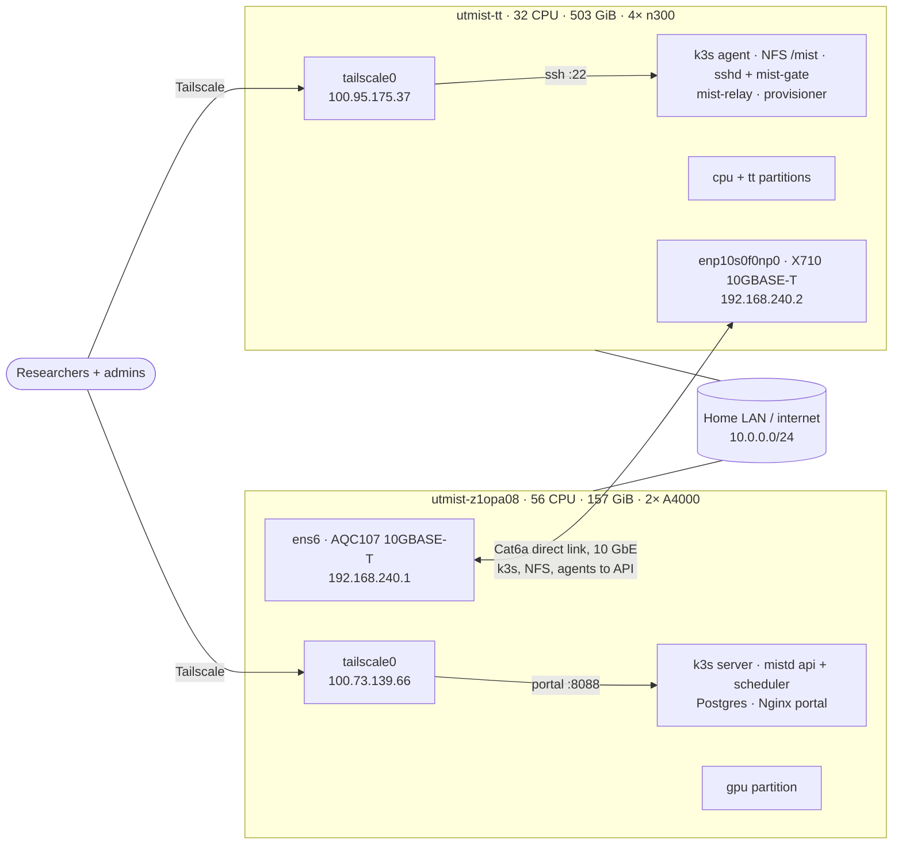

# Deployment and network

Covers which host runs what, how hosts and users connect, where configuration
and secrets live, admin access, and how nodes are added. Overview:
[ARCHITECTURE.md](../../../ARCHITECTURE.md). Related decisions: D7, D10, D13.

## Topology

## Hosts

| | `utmist-z1opa08` (NVIDIA) | `utmist-tt` (QuietBox) |
|---|---|---|
| Hardware | 56 CPUs, 157 GiB RAM, 2× RTX A4000 16 GB, 2× 447 GB SATA SSD | 32 CPUs, 503 GiB RAM, 4× n300 (8 chips), 3.6 TB NVMe |
| OS | Ubuntu 22.04, kernel 6.8, cgroup v2 | same |
| Roles | k3s server; `mistd api` + `mistd scheduler`; Postgres; portal (Nginx); `gpu` partition; backup target (M3) | k3s agent; `/mist` volume 1 + NFS server; login gateway (sshd, `mist-gate`, `mist-relay`); `mistd provision`; `cpu` and `tt` partitions |

## Networks

| Network | Addresses | Carries |
|---|---|---|
| **Direct link (10 GbE)** | NVIDIA `ens6` `192.168.240.1/24`, TT `enp10s0f0np0` `192.168.240.2/24` | k3s node traffic and Flannel, NFS, relay and provisioner → API, backups |
| LAN | NVIDIA `10.0.0.175` (currently over Wi-Fi), TT `10.0.0.112` | Internet access only |
| Tailscale | NVIDIA `100.73.139.66`, TT `100.95.175.37` | Users: portal (NVIDIA :8088), SSH login (TT :22); admin SSH |

**Moving the direct link to 10 GbE (M1):**

- **Cable:** Cat6a (or Cat6 under about 50 m) between the NVIDIA box's `ens6`
  (Aquantia AQC107) and the TT box's `enp10s0f0np0` (Intel X710). Both are
  10GBASE-T (RJ45) ports.
- **Addresses:** move `192.168.240.1/.2` from the 1 GbE I210 ports to those two
  ports, using a `/24` so more nodes can join.
- **MTU:** jumbo frames (9000) on both ends are optional, but help NFS.
- **Check:** `ethtool <iface>` shows `Speed: 10000Mb/s`. An `iperf3` run should
  reach above 9 Gb/s.

**Wired LAN.** The NVIDIA box should also reach the LAN over wired Ethernet
rather than Wi-Fi; one of its I210 ports frees up once the direct link moves.

**k3s** is installed fresh, with `--node-ip` and `--flannel-iface` on the direct
link, so cluster traffic never uses the LAN or Wi-Fi.

## Services

| Service | Host | Runs as |
|---|---|---|
| k3s server and agent | both | systemd |
| NVIDIA GPU Operator (device plugin + container toolkit) | NVIDIA | k3s |
| Tenstorrent DRA driver (M4) | TT | k3s |
| Postgres | NVIDIA | k3s StatefulSet, data on local SSD (never NFS) |
| `mistd api`, `mistd scheduler` | NVIDIA | k3s Deployments (1 replica each), reachable on `192.168.240.1` for agents |
| Portal (Nginx + static build) | NVIDIA | systemd, `:8088` on Tailscale, proxies `/api` |
| NFS server | TT | systemd |
| sshd + `mist-gate` | TT | systemd |
| `mist-relay` | TT | systemd (root) |
| `mistd provision` | TT (later every node) | systemd (root) |
| `mist-noded` (M5) | nodes moved to the node executor | systemd (root) |

## Configuration and secrets

- **Configuration in Git:** `deploy/` (manifests, systemd units, sshd and
  exports snippets, host setup scripts).
- **Settings in the database:** partitions, QoS, limits, volumes. Admins change
  them through the API.
- **Secrets never go in Git:**
  - Postgres credentials, the relay token and per-host agent tokens.
  - Kubernetes Secrets for in-cluster use; `/etc/mist/*.token` (0600 root) on
    hosts.
  - Rotate any secret that has been pasted into a chat or document.

## Admin access

- **Separate admin accounts** for each admin, with SSH keys only, `sudo`, and
  not in `mist-users`. Researcher accounts never have `sudo` or `docker`.
- **Password SSH disabled** on both hosts. The shared `utmist` and `utmist-tt`
  passwords are retired once admin accounts exist.
- **Clean up existing host state** after checking with whoever created it:
  - leftover local accounts (`dev`, `terrymist`, `labadmin`, `labmember`)
  - the `ollama` service and group
  - Docker
- **Device files stay `0666`** (D13). This is safe only because researcher
  logins can't run code and unmanaged GPU consumers are removed.

## Starting fresh

Before M1 goes live:

1. Stop and remove the previous platform's API, namespaces (`mist-team-*`),
   ConfigMaps and Jobs.
2. Keep the old storage folders untouched until a human confirms they can be
   deleted.
3. Reinstall k3s on the direct link.

## Adding a node

1. **Connect it to the direct-link network.** With three nodes, use the TT box's
   second X710 port, or better a 10 GbE switch with all nodes on
   `192.168.240.0/24`. Four or more nodes need the switch.
2. **Install Ubuntu** with the drivers for its accelerators.
3. **K3s executor:** join it as a k3s agent and install its device plugin. Node
   executor: install `mist-noded` and `mistd provision`.
4. **Register it in Mist:** add it to a partition (new or existing) and set its
   reserved host share.
5. **Run the executor conformance suite** on it, then mark it `up`.

## Work by milestone

- **M1:**
  - 10 GbE link and wired LAN
  - fresh k3s
  - Postgres
  - deploy `mistd` and the portal
  - gateway host setup
  - admin accounts and secret rotation
  - remove the old platform
- **M3:** backup target, and basic monitoring (disk space, node health, failed
  provisioner runs).

## Open questions

- Monitoring and alerting stack.
- Whether the NVIDIA box's `sdb` is free for scratch and backups.
- A stable login hostname.
