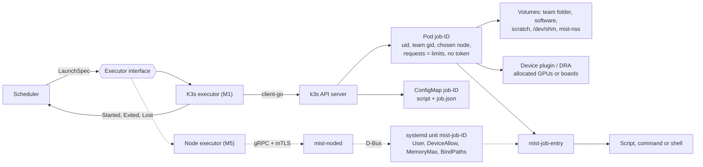

# Executors

An executor turns an admitted job into processes on a node, streams their I/O,
and reports what happened. The scheduler decides; the executor carries the
decision out. Overview: [ARCHITECTURE.md](../../../ARCHITECTURE.md). Related
decisions: D1, D2, D13, D16, D17.

There are two executors:

- the **K3s executor**, used from M1
- the **node executor** (M5), which runs jobs as systemd units without
  containers

Both implement the same interface and pass the same conformance tests. Each node
is managed by exactly one executor.

## How it fits

Both executors take the same `LaunchSpec` and end at the same `mist-job-entry`.
Only the middle differs:



## Interface

```go
package executor

type Executor interface {
    Name() string

    // Nodes reports schedulable capacity and health for nodes this executor manages.
    Nodes(ctx context.Context) ([]Node, error)

    // Launch ensures the one execution exists on spec.Node. Same ID/spec is
    // repeat-safe; never recreate an execution with a recorded native object
    // UID or evidence that it has started/ended after that object disappears.
    Launch(ctx context.Context, spec LaunchSpec) error

    // Terminate sends SIGTERM, then SIGKILL after grace. Idempotent.
    Terminate(ctx context.Context, jobID int64, grace time.Duration, reason string) error

    // Attach connects a terminal to a running interactive job; returns when the session ends.
    Attach(ctx context.Context, jobID int64, term Terminal) error

    // Logs streams the job's live output (stdout+stderr as written to the .out file).
    Logs(ctx context.Context, jobID int64, follow bool) (io.ReadCloser, error)

    // List returns every execution this executor knows about, for reconciliation.
    List(ctx context.Context) ([]Execution, error)

    // Events is an at-least-once notification stream. Persist and dedupe by
    // EventID; List/observation receipts recover missed notifications.
    Events() <-chan Event
}

type LaunchSpec struct {
    JobID        int64
    ExecutionID  string             // immutable UUID; one execution per job
    SpecHash     string             // immutable normalized spec digest
    AuthGeneration int64            // authorization used at admission
    LaunchDeadline time.Time        // admitted_at + launch timeout
    Kind         Kind               // Batch | Command | Interactive
    Node         string
    User         User               // Name, UID, PersonalGID
    TeamSlug     string
    TeamGID      int
    ExtraGIDs    []int              // mist-users
    Resources    Resources          // CPUs, MemoryBytes, GPUs, TTBoards, ScratchBytes
    DeviceIDs    []string           // optional; set when the scheduler assigns specific devices
    Mounts       []Mount            // resolved team folder + software (volume, source, target, readOnly)
    Workdir      string
    OutputPath   string
    Script       string             // Batch
    Args         []string           // Batch arguments (never shell-concatenated)
    Argv         []string           // Command
    Env          map[string]string  // frozen base; work-start/deadline fields derived at startup
    Runtime      string             // partition runtime image / host profile, pinned
    TimeLimit    time.Duration      // executor sets a backstop slightly beyond this
    SignalGrace  time.Duration
}

type Event struct {
    EventID  string      // stable across redelivery
    JobID    int64
    ExecutionID string
    Kind     EventKind   // Started | Finished | Exited | LaunchFailed | Lost
    Node     string
    ExitCode *int
    Reason   ExitReason  // Normal | OutOfMemory | ScratchExceeded | Deadline | Signaled | ...
    Detail   string      // human-readable, shown to users
    At       time.Time
}

type Node struct {
    Name       string
    Partitions []string
    Capacity   Resources
    Devices    []Device   // optional per-device inventory
    Healthy    bool
    Detail     string
}
```

The scheduler and API depend only on this package. Kubernetes and systemd types
never leak outside their executor packages. Define the supporting wire types in
this package before component implementations:

- `Execution`: JobID, ExecutionID, SpecHash, Node, observed phase, native object
  UID, started/finished timestamps, exit result, cleanup status and evidence.
- `Resources`: CPU millicores, memory/scratch bytes, whole GPU/board counts,
  hugepage bytes (M4). `Mount`: volume ID, source, absolute target, read-only.
- `Terminal`: byte input/output, resize and allowed signal controls, plus a
  cancellation context. Stream cancellation detaches; it does not cancel a job.
- `List` must distinguish unavailable/incomplete observations from authoritative
  absence. Failed calls are errors, never an empty successful list. Merge live
  objects with durable execution receipts; a watch stream is not a history store.

The executor persists create intent, object UID, start/finish observations and
cleanup receipts in executor-owned database tables through its package. Persist
finish metadata and bounded log tail before deleting execution objects. Scheduler
state changes and event consumption are transactional; events carry stable IDs.
Only the scheduler issues Launch/Terminate; the API uses read/log/attach methods.
A mismatched SpecHash for an existing ExecutionID is a hard conflict. M1 never
reruns an execution that has started, even if the process ended before a watch
observed it. A recorded native object UID also forbids recreating a missing Pod:
it may have run before deletion without a start notification. Without evidence
that an ambiguous creation never ran, report loss/quarantine rather than replay.
Durable tombstones prevent ID reuse after cleanup.

## Guarantees every executor must provide

These guarantees are tested by a shared **conformance suite**
(`internal/executor/conformance`) that runs against each implementation on real
nodes.

1. **Identity.** Processes run as `User.UID`. The primary group is `TeamGID`.
   Supplementary groups may contain only `ExtraGIDs`, `PersonalGID` and a
   redundant `TeamGID` (some runtimes include the primary group there). No other
   team/system groups are allowed. There is no privilege escalation or capability.
2. **Filesystem view.**
   - **Visible:** only the given mounts, at `/mist/teams/<team>` and
     `/mist/software` (read-only), plus `/scratch`. Other teams' folders are
     absent, not merely denied.
   - **Writable:** only the team folder (as permissions allow), `/scratch`,
     `/tmp` and memory-backed `/dev/shm`. `/tmp` lives inside scratch.
3. **Devices.** Only allocated GPUs/TT boards can be opened. CUDA presents the
   allocated GPU set with logical indices from 0; host device filenames need not
   be renumbered. Do not hard-code CUDA_VISIBLE_DEVICES=0 for every physical GPU;
   verify the plugin/runtime's UUID or index mapping for both A4000s. Native
   execution uses allocated physical IDs/UUIDs; CUDA remaps that visible set.
4. **Limits.** CPU and memory limits apply, swap is off, and scratch is capped.
   Hitting the memory limit gives `OutOfMemory`; detected scratch excess gives
   `ScratchExceeded`. K3s ephemeral storage limits are eviction thresholds, not
   synchronous write quotas. Reserve disk headroom and reject admissions under
   disk pressure. Include `/dev/shm` in the memory budget.
5. **Time limits.** `Terminate` delivers SIGTERM to the job's processes, then
   SIGKILL after the grace period. A backstop kills the job even if the
   scheduler is down.
6. **Network.**
   - **Allowed:** outbound internet and DNS.
   - **Blocked:** the LAN, the direct link, the Tailscale range, cluster
     services and the Kubernetes API.
   - **Inbound:** none.
7. **Output.** Output goes to `OutputPath` through `mist-job-entry` (below), and
   live output is also available from `Logs`.
8. **Cleanup.** When the job ends, all of its processes are gone, scratch is
   deleted and devices are free. `Finished` reports process exit; `Exited`
   acknowledges completed cleanup. Allocation release requires `Exited` or an
   equivalent durable cleanup receipt. Failed cleanup keeps capacity reserved;
   node loss quarantines it until reconciliation proves cleanup.
9. **Repeat-safe and recoverable.** Repeating `Launch` or `Terminate` is safe.
   After a restart, `List` reports what is actually running.

## `mist-job-entry`

A small static Go binary that is the first process of every job, under any
executor. It is the single place that implements the job contract in
[runtime-environment.md](runtime-environment.md):

1. **Set up:**
   - set `umask 0027`
   - create, or reset to `0700`, `$HOME/{.cache,.config,.local,.ssh}`
   - create the output file and write a header (job ID, node, resources, start
     time)
2. **Run the work:**
   - **Batch:** `bash <script> <args>`
   - **Command:** run the argv directly
   - **Interactive:** the holder creates one persistent PTY and login shell,
     then accepts attach clients; the shell starts once per execution
3. **Handle output and signals:**
   - copy stdout and stderr to both the output file and its own stdout, so live
     logs work under any executor
   - forward SIGTERM to the job's process group
4. **On exit:**
   - work out the reason (for example `oom_kill` in the cgroup's
     `memory.events`)
   - write a footer: end time, exit code, reason, elapsed time, peak memory
   - report a structured result to the executor (on K3s, through the pod's
     termination message)
   - exit with the child's exit code

The interactive holder owns the PTY master for the job's lifetime. An attach
helper (`mist-job-entry --attach`) connects to its job-private Unix socket and
relays framed bytes/resizes/signals; it never starts another shell. Use one
attached client at a time (second attach returns `conflict`), with a bounded
64 KiB output ring while detached. Drain the PTY even when disconnected. Reattach
preserves shell PID, cwd, variables and foreground processes; replay is marked so
clients do not mistake buffered bytes for new output. Do not log terminal input.
The holder records detach time, enforces the 10 min grace locally and reports it
through execution observations. API restart closes transport but not the PTY;
reconnection does not depend on API memory. Holder death fails the job rather
than silently creating a fresh shell. The holder and shell share the job cgroup.

An unprivileged wrapper cannot guarantee a footer after SIGKILL, OOM or node
failure, and cannot be trusted as the sole source of limit/cleanup evidence.
Use kubelet/cgroup observations for authoritative reasons. Persist a synthetic
final message in the DB tail when needed; expose `output_incomplete` if the
`.out` file could not be finalized. Never run privileged file writes against
user-controlled output paths to repair a missing footer.

## K3s executor (M1)

### Objects

All jobs run in one namespace, `mist-jobs`. Each job gets:

- **A Pod `job-<id>`.** Not a Kubernetes Job, because Mist owns state. Label it
  with `mist/job-id`, `mist/execution-id`, `mist/partition` and `mist/team`;
  annotate the SpecHash and record its Kubernetes UID in the execution receipt.
- **A ConfigMap `job-<id>`** holding the script and `job.json`. The Pod owns it,
  so Kubernetes deletes it with the Pod. Create the ConfigMap first, create the
  Pod, then patch the owner reference with the Pod UID; reconcile crashes between
  steps and garbage-collect orphan ConfigMaps. Never overwrite a conflicting spec.
- **A ResourceClaim** for TT boards (M4), using the existing Tenstorrent DRA
  driver.

### Pod spec essentials

| Field | Value | Why |
|---|---|---|
| Placement | `nodeName` for GPU/CPU; exact unique node selector and no `nodeName` for TT/DRA | Mist chooses admission and node; Kubernetes allocates TT claims (D18) |
| `restartPolicy` | `Never` | No silent restarts |
| `activeDeadlineSeconds` | launch timeout + time limit + grace + 60 s | Coarse backstop; pod lifetime includes startup |
| `terminationGracePeriodSeconds` | signal grace | SIGTERM → SIGKILL timing |
| `automountServiceAccountToken`, `enableServiceLinks` | `false` | No cluster access from jobs |
| `securityContext` | `runAsUser: uid`, `runAsGroup: team gid`, `supplementalGroups: [19000, personal gid]`, `supplementalGroupsPolicy: Strict`, `runAsNonRoot`, `seccompProfile: RuntimeDefault` | D4, D5 |
| container `securityContext` | `allowPrivilegeEscalation: false`, drop `ALL` capabilities, `readOnlyRootFilesystem: true` | Writes go only to `/mist`, `/scratch`, `/tmp` |
| **no `fsGroup`** | — | `fsGroup` would rewrite ownership of team files |
| resources | requests = limits for `cpu`, `memory`, `nvidia.com/gpu`, `ephemeral-storage` | Guaranteed QoS class; the device plugin isolates GPUs |
| image | partition runtime, pinned by digest | Same environment for batch and interactive |

### Volumes

| Mount | Source |
|---|---|
| `/mist/teams/<team>` | NFS `<volume addr>:<export>/teams/<team>`, or `hostPath` when the node hosts the volume |
| `/mist/software` (ro) | NFS or `hostPath`, likewise |
| `/scratch`, `/tmp` | one `emptyDir` with `sizeLimit` = scratch request (`/tmp` is a sub-path) |
| `/dev/shm` | `emptyDir`, `medium: Memory`, sized to half the memory request (PyTorch DataLoader workers need it) |
| `/etc/passwd`, `/etc/group` | Per-job `mist-nss` projection: required system entries, submitter and charged-team identities only; no other-team membership data |
| `/etc/mist/job.json`, script | ConfigMap `job-<id>` |

### Network

A NetworkPolicy in `mist-jobs` denies all inbound traffic. It allows outbound
traffic to DNS and to the internet, except `10.0.0.0/8`, `172.16.0.0/12`,
`192.168.0.0/16` and `100.64.0.0/10`. k3s's built-in policy controller enforces
it. Also install host-level filtering for job-origin traffic to the local node
and its services; ordinary NetworkPolicy alone is not the host boundary. The
complete policy and tests are in [deployment-and-network.md](deployment-and-network.md#job-network-boundary-m1).
DNS is an explicit port-53 exception to approved resolvers, not a blanket cluster
service exception. Disable IPv6 for job networks until equivalent filtering is
verified. Test both local and remote host addresses and service IPs.

**Isolation gate (found in M1 step 5).** k3s's policy controller (kube-router)
programs a Pod's rules about a second *after* its containers start. In k3d, a
job's first connections to the API service, the node's API server and kubelet
all succeeded, and the same probes were blocked a second later. Every job Pod
therefore has an init container, `mist-job-entry -await-isolation
$(MIST_HOST_IP):10250`. It shares the Pod's network namespace and passes only
after three consecutive failed connections to the node's kubelet, which is
known to be listening because it is starting the Pod. After 60 s it fails
closed, and the job becomes `LAUNCH_FAILED`. Jobs use `dnsPolicy: None` with
approved public resolvers, so they never need cluster DNS. Once rules are in
place, kube-router also filters job traffic to its own node (INPUT and OUTPUT
chains) in k3d. That still has to be shown on the real hosts, together with
the host firewall.

### Status mapping

| Observed | Event |
|---|---|
| Container started (interactive holder ready for M2) | `Started`, with actual start time; never informer receipt time |
| Container terminated | `Finished`; persist result/log tail and begin cleanup. Prefer trusted OOM/deadline/eviction observations over wrapper messages. |
| Cleanup verified | `Exited` with durable outcome and cleanup receipt |
| Definitive admission rejection, image/mount/startup timeout before work starts | Clean partial resources, then `LaunchFailed`; no automatic new execution |
| Pod deleted outside Mist, or node `NotReady` > 2 min with the pod unknown | `Lost` |

The executor watches pods (filtered by label) and nodes through shared
informers. `Nodes()` reports node allocatable values for CPU, memory,
`nvidia.com/gpu` and ephemeral storage, plus TT board counts from DRA resource
slices. Report capacity net of Kubernetes host/system reservations, and expose
that reservation explicitly so Mist does not subtract it twice. Subtract any
additional Mist reserve once. Account for non-Mist workloads in the reserved
budget; prohibit unmanaged workload placement on compute capacity. Nodes with
unsupported strict groups, swap configuration or missing firewall rules are not
healthy. Pin k3s, runtime and plugin versions and run conformance before upgrades.

Startup timeout defaults to 10 min from admission, including image pulls, mounts
and DRA. No workload-start retry after that timeout. `mist-job-entry` has a local
monotonic time-limit timer from work start, and the executor has an independent
backstop; user-controlled wrapper state is not sufficient enforcement. M1 must
verify the installed runtime's deadline behavior with the scheduler stopped.
The coarse Pod backstop can allow up to the launch-timeout allowance beyond
normal walltime, plus its documented grace/polling slack; do not advertise it as
an exact work-start timer. The normal scheduler and local wrapper enforce the
work-start deadline. Test and record the maximum outage overrun on the pinned
runtime, including a stopped wrapper; if exact outage timing is required, add a
trusted node deadline supervisor before claiming that stronger guarantee.
Strict supplemental groups require runtime support; check the node feature and
actual process groups, rather than trusting an accepted field. Reference:
[Kubernetes security context](https://kubernetes.io/docs/tasks/configure-pod-container/security-context/).

### Logs and attach

- **`Logs`** uses `pods/log` (with `follow`), which carries the copy of the
  output that `mist-job-entry` writes to stdout.
- **`Attach`** uses `pods/exec` without allocating a second TTY, running only
  the fixed `mist-job-entry --attach` helper. Framed resize/signal controls go to
  the holder's existing PTY. Closing exec detaches. Shell exit ends the holder
  with the shell's exit code; it is not inferred from exec transport closure.
  The relay/API preserve stream framing and backpressure without buffering
  unbounded output.

### Implementation notes (M1)

- **Terminate** shortens the Pod's `activeDeadlineSeconds`, which may only
  decrease, instead of deleting the Pod. Kubelet sends SIGTERM, then SIGKILL
  after `terminationGracePeriodSeconds` (the job's signal grace), and keeps the
  final status, so the result and log tail are saved before the executor
  deletes the Pod.
- **`/tmp`** is the scratch emptyDir mounted a second time, not a `subPath`:
  kubelet creates subPath directories root-owned, so a non-root job could not
  write to them.
- **Pod Security admission** is not enabled on `mist-jobs`: the `restricted`
  and `baseline` levels both forbid the hostPath that jobs on the volume's host
  need. The pod builder's invariant tests guard the security fields instead,
  and only mistd may create Pods there.
- **Receipts** live in `k3s_executions` and `k3s_receipts`. A recorded Pod
  UID forbids recreating the Pod. A create whose response was lost is read
  back by name and adopted only if its execution ID and spec hash match.

### Cleanup and reconciliation

<a id="reconciliation"></a>

- Persist `Finished`, exit metadata and the log tail before deletion; scheduler
  enters `CLEANING` and keeps the allocation. Delete the pod and its owned
  resources promptly; do not retain live storage for a debugging window.
- Deletion from the API is not proof that the node stopped or deleted scratch.
  A privileged, narrowly scoped cleanup reporter on each K3s node confirms the
  recorded container/cgroup is gone, that execution's scratch volume is removed
  and device teardown completed. It must verify execution/object UID and safe
  paths; it never deletes arbitrary paths supplied by jobs. Send authenticated,
  durable receipts via the internal API. Missing reporter/receipt keeps capacity
  reserved and alerts an admin. TT also requires a successful board reset.
- Only then emit `Exited` and release resources. Keep diagnostics and tombstones
  in the database, including when API deletion or cleanup is retried.
- Compare authoritative observations every 60 s and on restart. Follow the
  state-specific matrix in [scheduler.md](scheduler.md#reconciliation): a missing
  pod for an unstarted `LAUNCHING` intent is recoverable, not automatically Lost.
- Unknown executions are stopped and quarantined until cleanup is proven.
  A timed-out launch request is ambiguous: read back the same object identity;
  never create a replacement ID. Serialize per-job launch/stop operations and
  drain in-flight calls before acknowledging cleanup. If a late creation cannot
  be excluded, keep the node quarantined and reconcile; never release capacity
  merely because one read returned NotFound.

### RBAC

`mistd`'s service account gets:

- in `mist-jobs`: `pods`, `pods/log`, `pods/exec`, `configmaps` and
  `resourceclaims`
- cluster-wide: read-only `nodes` and `resourceslices`

### Tenstorrent (M4)

- **Allocation:** after Mist commits admission, create board DRA claims and a
  Pod constrained by an exact unique node selector. Do not set `nodeName`:
  Kubernetes must allocate/reserve claims before kubelet can start the Pod.
  Mist still decides when and on which node work is admitted. Claim failure
  triggers launch-timeout cleanup, never placement on another node.
- Include `hugepages-1Gi` in discovery, admission and the immutable allocation
  ledger, with a matching `/dev/hugepages` mount. Record exact boards from the
  allocated claims before work starts; board identity is needed in M4 for reset.
  Validate the installed DRA driver's n300 board/chip granularity and reset
  scope on hardware before enabling concurrent TT jobs.
- **Reset after each TT job:** a short privileged pod, created by the executor
  on that node, runs `tt-smi -r` on the job's boards. The allocation is released
  only when the reset succeeds and claim teardown is confirmed. Keep the node
  unavailable for new TT admissions while resetting unless the driver proves
  board-local reset cannot affect other jobs. A failed reset quarantines the
  affected board (or the whole node if reset scope is uncertain).

## Node executor (M5)

It provides the same guarantees with no container runtime. One agent,
`mist-noded`, runs as root on each node it manages and talks to `mistd` over
gRPC with mTLS on the direct link.

### Launch

The agent starts a systemd **transient unit** `mist-job-<id>.service` (in
`mist-jobs.slice`) over D-Bus:

| Guarantee | systemd property |
|---|---|
| Identity | Root-owned launcher performs explicit `setgroups(ExtraGIDs + PersonalGID)`, `setresgid(TeamGID)`, `setresuid(UID)`, drops all capability sets, and verifies credentials before exec; `NoNewPrivileges=yes`, `UMask=0027` |
| CPU and memory | `AllowedCPUs=` (a CPU set per allocation), `MemoryMax=`, `MemorySwapMax=0`, `TasksMax=` |
| Devices | `DevicePolicy=closed` + `DeviceAllow=` for the allocated `/dev/nvidiaN` (plus `nvidiactl`, `nvidia-uvm*`) or `/dev/tenstorrent/N`; `CUDA_VISIBLE_DEVICES` set to match |
| Filesystem view | `TemporaryFileSystem=/mist/teams:ro` + `BindPaths=/mist/teams/<team>`; `BindReadOnlyPaths=/mist/software`; scratch bound at `/scratch` and `/tmp`; `ProtectSystem=strict`, `ProtectHome=yes` |
| Network | Per-job network namespace and veth through the same outbound-only host firewall policy as K3s; DNS exception only to approved resolvers |
| Time limit | `RuntimeMaxSec=` as backstop; `KillSignal=SIGTERM`, `TimeoutStopSec=` grace |
| Exit reason | Unit `Result=` (`oom-kill`, `timeout`, `exit-code`) and `ExecMainStatus` |

systemd's default `OOMPolicy=stop` also sends SIGTERM to the rest of the unit after a kernel OOM kill (observed in the M1 `mist-job-entry` cgroup test). Pin `OOMPolicy` explicitly, and take the reason from `Result=oom-kill` or `memory.events`, not from the exit status.

### Interactive sessions

Use the same persistent holder/PTY protocol as K3s, inside the main job unit.
The agent streams bytes to its Unix socket over gRPC; it does not launch a second
unit with independent resource limits. Agent restart reconnects to the surviving
holder without replacing the shell. All shell descendants share the allocation's
limits, mounts, devices and cancellation boundary.

`SupplementaryGroups=` extends NSS memberships; it is not a replacement list.
Do not rely on `User=` plus that setting to isolate a multi-team account. The
credential launcher is trusted, minimal, takes only validated root-owned job
specs, fails closed on every setup error, and drops privilege before any user
file or shell startup code is executed. Hide host process/runtime sockets and
other user paths as well as `/mist/teams`; use a private PID/mount/network view.
A systemd property table alone is not proof of parity with container isolation.
The M5 prototype must pass the complete conformance suite before migration.

### Prerequisites

- **Accounts on the node:** Linux accounts must exist there, so the provisioner
  runs on every node it manages.
- **Matching software:** the host's software must match the partition's runtime
  profile. See [runtime-environment.md](runtime-environment.md).
- **Specific devices:** the scheduler records exact device IDs in allocations.

### Moving a node from K3s to the node executor

1. Drain the node in Mist.
2. Exclude it from the device plugin and DRA driver.
3. Start `mist-noded`.
4. Point the partition (or a new one) at the node executor.
5. Run the conformance suite.
6. Mark the node `up`.

## Work by milestone

- **M1:**
  - the interface and conformance suite
  - `mist-job-entry`
  - the K3s executor for batch and command jobs on `gpu` and `cpu`
  - durable receipts, cleanup reporter, state-specific reconciliation
  - network enforcement and credential/permission conformance
- **M2:** `Attach` and the interactive holder.
- **M4:** TT allocation, hugepages and board reset.
- **M5:** the node executor, which passes the same conformance suite.

## Platform references

Use documentation matching the pinned deployed versions; these references explain
why the contracts above cannot be inferred from Pod existence or a field alone:

- [DRA and pre-scheduled Pods](https://kubernetes.io/docs/concepts/resource-management/dynamic-resource-allocation/how-dra-works/)
- [Local ephemeral storage accounting and eviction](https://kubernetes.io/docs/concepts/storage/ephemeral-storage/)
- [emptyDir lifecycle](https://kubernetes.io/docs/concepts/storage/volumes/#emptydir)
- [systemd supplementary-group behavior](https://www.freedesktop.org/software/systemd/man/258/systemd.exec.html)
