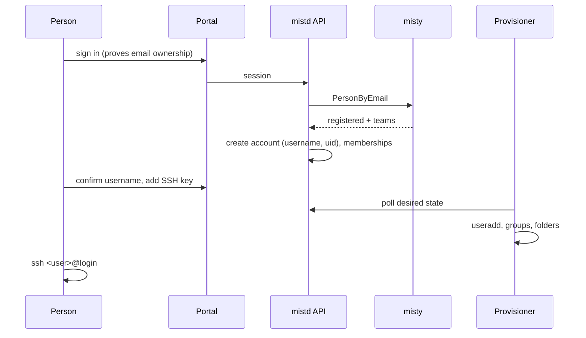

# Identity and accounts

Covers who people are, which teams they belong to, the Linux identities Mist
gives them, how they sign up, and how accounts reach the hosts. Overview:
[ARCHITECTURE.md](../../../ARCHITECTURE.md). Related decisions: D4, D5, D14.

## Responsibilities

- Read people, teams and membership from **misty**, and cache them in Mist.
- Create and keep **Mist accounts**: usernames, UIDs, team GIDs and roles.
- Store and serve **SSH public keys**.
- Authenticate portal users and authorize API calls (who may act on what).
- Publish the **desired host state** that the provisioner applies: users,
  groups and team folders.

## Misty

Misty is the source of truth for people, teams and membership. Mist reads it
and never writes to it. Until its API is available, Mist uses a stub with the
same Go interface:

```go
type Directory interface {
    PersonByEmail(ctx context.Context, email string) (Person, error) // ErrNotRegistered
    Person(ctx context.Context, id string) (Person, error)
    Teams(ctx context.Context) ([]Team, error)
    Memberships(ctx context.Context) ([]Membership, error)
}

type Person     struct{ ID, Email, DisplayName string }
type Team       struct{ ID, Name string }
type Membership struct{ PersonID, TeamID string; Role string } // "member" | "lead"
```

- **Stub.** A YAML file (`deploy/dev/misty-stub.yaml`) loaded at start-up and
  re-read when it changes. Tests use in-memory fixtures.
- **Sync.** `mistd api` refreshes the cache every few minutes, and re-reads one
  person's teams whenever they sign in. Membership changes therefore apply
  within minutes. Webhooks can replace polling if misty offers them.
- **Effect of a membership change:**
  - **Added to a team:** the provisioner creates the person's folder in that
    team, and the next login sees it.
  - **Removed from a team:** the person loses the team's group. Their running
    jobs charged to that team are cancelled. Their folder stays (see
    offboarding below).

## Mist account model

| Field | Rules |
|---|---|
| `username` | `^[a-z][a-z0-9-]{1,30}$`. Proposed at sign-up (from the email's local part) and editable once before confirmation, then **immutable**. Never reused. |
| `uid` | Allocated from **20000–29999**, never reused. The user's personal group has the same number as GID. |
| `misty_person_id` | Link to misty. One account per person. |
| `status` | `active`, `disabled` (cannot log in or submit; files kept) |
| `is_admin` | Mist platform administrator (separate from misty roles) |

| Team field | Rules |
|---|---|
| `slug` | `^[a-z][a-z0-9-]{1,30}$`, chosen when Mist first sees the team, immutable. Used in paths and group names. |
| `gid` | Allocated from **40000–49999**, never reused. Linux group `team-<slug>`. |
| `volume_id` | The storage volume holding the team folder (see [storage.md](storage.md)) |

All researcher accounts also belong to the group `mist-users` (GID 19000), which
the login gateway uses to select the restricted SSH configuration. These ranges
avoid the hosts' existing local accounts (UID 1000–1003).

## Roles

| Role | Source | Can |
|---|---|---|
| Member | misty membership | Use the team's folder; submit jobs charged to the team; see the team's jobs |
| Team lead | misty role `lead` | Also: cancel any job charged to the team; see the team's usage breakdown |
| Mist admin | Mist `is_admin` | Configure partitions, QoS, limits and volumes; disable accounts; see everything in the portal |

Authorization checks happen in the API, through one shared middleware and helper
(`identity.Authorize(principal, action, resource)`). Endpoints never check
permissions in their own ad-hoc way.

## Sign-up and sign-in



- **Proving identity.** Signing in must prove that the person controls the email
  misty has on record, so that knowing someone's email isn't enough. The method
  is open: Google or UofT SSO through OAuth, or a one-time email link. Until it
  is chosen, the portal keeps a session cookie for signed-in users.
- **Not registered in misty:** sign-in shows "register with UTMIST first". No
  account is created.
- **No teams:** the account can exist but has no folders and cannot submit jobs.

## SSH keys

- Types allowed: `ssh-ed25519`, `ecdsa-sha2-*`, `ssh-rsa` of at least 3072 bits;
  at most 10 keys per account. Each key has a label and a last-used time.
- **Served live, not written to files.** sshd's `AuthorizedKeysCommand` calls
  `mist-relay keys <user>`, which asks the API. The relay keeps the last good
  answer, so logins keep working briefly if `mistd` is down (see
  [login-gateway.md](login-gateway.md)).
- A disabled account has no keys served.

## Provisioner

`mistd provision` runs as root under systemd on every host that needs Linux
accounts or owns a volume. Today that is the TT box. With the K3s executor,
compute nodes don't need accounts, because pods run as numeric UIDs. The native
executor (M5) will need the provisioner on every compute node.

It **pulls** the desired state; the API never pushes changes to hosts.

```
GET  /internal/v1/provision/state     → users, groups, memberships, teams+volumes, generation
POST /internal/v1/provision/report    ← per-host applied generation, errors, usage snapshot
```

It applies the state idempotently:

1. **Groups:** `mist-users`, `team-<slug>` (fixed GIDs) and personal groups.
2. **Users:** fixed UID, login home `/mist/login/<user>`, supplementary groups.
   The login shell is irrelevant because the gateway forces its own command.
3. **Folders on volumes this host owns.** The modes are listed in
   [storage.md](storage.md):
   - the team folder, `shared/` and `.cache/`
   - each member's folder, with its private hidden folders
   - the login landing folder, with one link per team
4. **Disabling:** an account is locked (`usermod -L`, removed from groups), not
   deleted. **The provisioner never deletes researcher files.**
5. **Refusals:** it refuses to act on any path outside configured volume roots,
   and on UID or GID collisions with existing local accounts, and reports them.

Hosts authenticate to the internal API with per-host tokens (M1), or mTLS later.

## API endpoints owned

| Endpoint | Purpose |
|---|---|
| `GET /v1/me` | Account, teams, roles, status |
| `PATCH /v1/me` | Confirm username (once) |
| `GET/POST/DELETE /v1/me/ssh-keys[/{id}]` | Manage keys |
| `GET /v1/teams`, `GET /v1/teams/{slug}` | Teams visible to the caller, with members |
| `GET /v1/admin/accounts`, `PATCH /v1/admin/accounts/{username}` | Admin: list, disable or enable |
| `GET /internal/v1/provision/state`, `POST /internal/v1/provision/report` | Provisioner |
| `GET /internal/v1/ssh-keys/{username}` | Relay key lookup |

## Database tables owned

`people` (misty cache), `teams`, `memberships`, `accounts`, `ssh_keys`,
`id_allocations`, `provision_reports`, `sessions`.

## Work by milestone

- **M1:**
  - misty stub
  - accounts with UID allocation
  - sign-in, using an interim method if SSO isn't ready
  - SSH keys
  - provisioner: users, groups and folders
  - key lookup for the relay
- **M3:** team-lead permissions in the portal, and admin account management.
- **Later:**
  - the real misty client
  - SSO
  - personal API tokens, so the CLI works from laptops
  - the provisioner on every compute node (M5)

## Open questions

- Misty API shape, and polling versus webhooks.
- Sign-in method.
- Offboarding: when someone leaves a team, does their folder stay team-readable
  forever, pass to the team lead, or get archived after N days?
