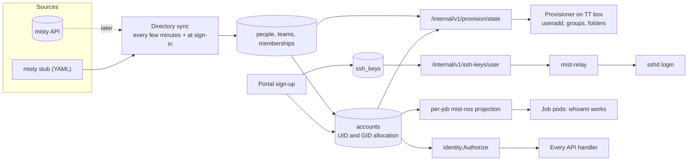
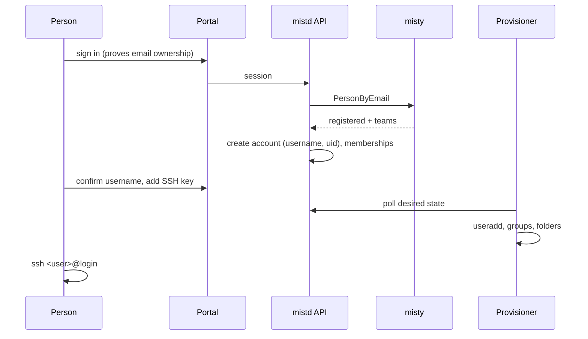

# Identity and accounts

Covers who people are, which teams they belong to, the Linux identities Mist
gives them, how they sign up, and how accounts reach the hosts. Overview:
[ARCHITECTURE.md](../../../ARCHITECTURE.md). Related decisions: D4, D5, D14.

## Responsibilities

- Read people, teams and membership from **misty**, and cache them in Mist.
- Create and keep **Mist accounts**: usernames, UIDs, team GIDs and roles.
- Store and serve **SSH public keys**.
- Authenticate portal users and authorize API calls (who may act on what).
- Publish the **desired host state** that the provisioner applies: users,
  groups and team folders.

## How it fits

Identity data flows from misty into Mist's tables, and from there out to every
place that needs to know who someone is.



## Misty

Misty is the source of truth for people, teams and membership. Mist reads it
and never writes to it. Until its API is available, Mist uses a stub with the
same Go interface:

```go
type Directory interface {
    PersonByEmail(ctx context.Context, email string) (Person, error) // ErrNotRegistered
    Person(ctx context.Context, id string) (Person, error)
    Teams(ctx context.Context) ([]Team, error)
    Memberships(ctx context.Context) ([]Membership, error)
}

type Person     struct{ ID, Email, DisplayName string }
type Team       struct{ ID, Name string }
type Membership struct{ PersonID, TeamID string; Role string } // "member" | "lead"
```

- **Stub.** Development uses `deploy/dev/misty-stub.yaml`; tests use in-memory
  fixtures. Until misty's real API is available, M1 can use an admin-maintained,
  access-controlled directory YAML outside Git with actual authorized members.
  Re-read it on each directory poll, validate the complete snapshot and audit
  changes; malformed/unreadable input does not renew freshness. Neither form
  supplies sign-in authentication or bypasses the revocation protocol.
- **Sync.** `mistd api` refreshes a complete directory snapshot every 60 s,
  and refreshes at sign-in. Publish snapshots atomically with a generation and
  `observed_at`; partial/failed fetches must not be interpreted as mass removal.
  A snapshot is usable for new authorization for at most 5 min. Failure to
  refresh does not extend that validity. Webhooks may trigger an earlier poll.
- **Effect of a membership change:**
  - **Added to a team:** the provisioner creates the person's folder in that
    team, and the next login sees it.
  - **Removed from a team:** revoke access using the protocol below, including
    pending and launching jobs and existing SSH sessions. Files remain.

## Mist account model

| Field | Rules |
|---|---|
| `username` | `^[a-z][a-z0-9-]{1,30}$`. Proposed at sign-up (from the email's local part) and editable once before confirmation, then **immutable**. Never reused. |
| `uid` | Allocated from **20000–29999**, never reused. The user's personal group has the same number as GID. |
| `misty_person_id` | Link to misty. One account per person. |
| `status` | `active`, `disabled` (cannot log in or submit; files kept) |
| `is_admin` | Mist platform administrator (separate from misty roles) |

| Team field | Rules |
|---|---|
| `slug` | `^[a-z][a-z0-9-]{1,30}$`, chosen when Mist first sees the team, immutable. Used in paths and group names. |
| `gid` | Allocated from **40000–49999**, never reused. Linux group `team-<slug>`. |
| `volume_id` | The storage volume holding the team folder (see [storage.md](storage.md)) |

All researcher accounts also belong to the group `mist-users` (GID 19000), which
the login gateway uses to select the restricted SSH configuration. This group
is permanent, including while disabled or without teams. It grants no team data
access. These ranges avoid existing local accounts (UID 1000–1003).

Reject reserved usernames (`shared`, service/admin names and existing local
users), namespace collisions and overlong `team-<slug>` group names before
allocating an identity. Require uniqueness for usernames, slugs, person IDs,
UIDs and GIDs in database constraints. Freeze the username before provisioning.

## Roles

| Role | Source | Can |
|---|---|---|
| Member | misty membership | Use the team's folder; submit jobs charged to the team; see the team's jobs |
| Team lead | misty role `lead` | Also: cancel any job charged to the team; see the team's usage breakdown |
| Mist admin | Mist `is_admin` | Configure partitions, QoS, limits and volumes; disable accounts; see everything in the portal |

Authorization checks happen in the API, through one shared middleware and helper
(`identity.Authorize(principal, action, resource)`). Endpoints never check
permissions in their own ad-hoc way.

## Sign-up and sign-in



- **Proving identity.** Signing in must prove that the person controls the email
  misty has on record, so that knowing someone's email isn't enough. The method
  is open: Google or UofT SSO through OAuth, or a one-time email link. Choose
  and test one before production M1; a session cookie is not an identity proof.
  Development fixture authentication must be absent from production builds.
- **Not registered in misty:** sign-in shows "register with UTMIST first". No
  account is created.
- **No teams:** the account can exist but has no folders and cannot submit jobs.

## SSH keys

- Types allowed: `ssh-ed25519`, `ecdsa-sha2-*`, `ssh-rsa` of at least 3072 bits;
  at most 10 keys per account. Each key has a label and a last-used time.
- **Served live, not written to files.** sshd's `AuthorizedKeysCommand` calls
  `mist-relay keys <user>`, which asks the API. Any cached answer is bounded
  by the account's authorization lease and applied host generation (see
  [login-gateway.md](login-gateway.md)); there is no 24-hour fallback.
- A disabled account has no keys served.

## Provisioner

`mistd provision` runs as root under systemd on every host that needs Linux
accounts or owns a volume. Today that is the TT box. With the K3s executor,
compute nodes don't need accounts, because pods run as numeric UIDs. The native
executor (M5) will need the provisioner on every compute node.

It **pulls** the desired state; the API never pushes changes to hosts.

```
GET  /internal/v1/provision/state     → users, groups, memberships, teams+volumes, generation
POST /internal/v1/provision/report    ← per-host applied generation, errors, usage snapshot
```

It applies the state idempotently:

1. **Groups:** `mist-users`, `team-<slug>` (fixed GIDs) and personal groups.
2. **Users:** fixed UID, login home `/mist/login/<user>`, supplementary groups.
   Set a fixed admin-controlled shell and disable user startup hooks; sshd
   invokes ForceCommand through that shell, so its configuration matters.
3. **Folders on volumes this host owns.** The modes are listed in
   [storage.md](storage.md):
   - the team folder, `shared/` and `.cache/`
   - each member's folder, with its private hidden folders
   - the login landing folder, with one link per team
4. **Disabling:** write a root-owned local deny entry before changing team
   groups; retain `mist-users` and the personal group. Expire the account for
   SSH/PAM as defense in depth; password locking alone is insufficient. Kill
   gateway sessions through their tracked cgroups. **Never delete files.**
5. **Refusals:** it refuses to act on any path outside configured volume roots,
   and on UID or GID collisions with existing local accounts, and reports them.

Hosts authenticate to the internal API with per-host tokens (M1), or mTLS later.

## Revocation and provisioning barrier (M1)

1. Identity changes account/membership state, increments its authorization
   generation, invalidates affected web sessions, and writes a durable revocation
   record in one transaction. Scheduler admission and cancellation use Identity's
   package with the same transaction/locking order (account, membership, job).
2. Scheduler cancels affected `PENDING` jobs and persists stop intent for
   `LAUNCHING`/`RUNNING` jobs. Disabled accounts affect every team. No subsequent
   admission or launch replay may use an older authorization generation.
3. The gateway polls desired state every 30 s. Before applying removed groups it
   denies new sessions for the UID, invalidates cached keys, closes all that
   user's SSH transports/channels (including multiplexed sessions), and kills
   their gateway session cgroups. Existing processes retain old groups, so
   editing `/etc/group` alone is not revocation. Then apply memberships/links and
   acknowledge the generation before permitting a fresh login if still active.
4. Key lookup and session establishment require an active account, an unexpired
   authorization lease and an applied host generation at least as new as the
   lease. Leases expire at the earlier of issuance + 5 min and directory snapshot
   expiry. The root gateway watchdog terminates sessions when leases expire;
   restarting it must not reset expiry. During an API outage cached access can
   continue only to that expiry, then both new and existing sessions are denied.
   Renew online leases every 30 s while eligible; never renew from a stale
   directory snapshot. Persist expiry in root-owned state, use monotonic elapsed
   time within a boot, and invalidate leases on reboot or clock rollback.
5. Scheduler admission also requires ready folders for the charged team and a
   provisioner report no older than 2 min; otherwise use `PROVISIONING`. An
   authorization service/directory outage uses `AUTH_UNAVAILABLE`, not a stale
   grant. Running jobs retain their bounded time limit during an outage; known
   revocations are stopped and enforced on node recovery.

Newly added membership also increments the generation; admission refreshes the
current authorized generation only after provisioning acknowledges it. An
unstarted old-generation launch is cancelled and must be resubmitted rather than
mutating its frozen LaunchSpec.

Report `revocation_pending` until gateway and job-stop acknowledgements arrive;
an unreachable node may still be executing work. Do not claim immediate remote
revocation during a partition. Keep it unschedulable until reconciled. API
requests and streams reject known revoked membership immediately. Key deletion
invalidates key caches and terminates gateway sessions for that account (M1
uses this conservative policy rather than tracking which key each channel used).

Provision state includes per-account generations, active/deny state, lease expiry,
team placement and membership; reports include applied generations, session-kill
acknowledgements, readiness and errors. These are durable fields, not in-memory
notifications. File-retention policy is independent from access revocation.

## API endpoints owned

| Endpoint | Purpose |
|---|---|
| `GET /v1/me` | Account, teams, roles, status |
| `PATCH /v1/me` | Confirm username (once) |
| `GET/POST/DELETE /v1/me/ssh-keys[/{id}]` | Manage keys |
| `GET /v1/teams`, `GET /v1/teams/{slug}` | Teams visible to the caller, with members |
| `GET /v1/admin/accounts`, `PATCH /v1/admin/accounts/{username}` | Admin: list, disable or enable |
| `GET /internal/v1/provision/state`, `POST /internal/v1/provision/report` | Provisioner |
| `GET /internal/v1/ssh-keys/{username}` | Relay key lookup |

## Database tables owned

`people` (misty cache), `teams`, `memberships`, `accounts`, `ssh_keys`,
`id_allocations`, `provision_reports`, `sessions`, `revocations`, `authorization_leases`.

## Work by milestone

- **M1:**
  - misty stub
  - accounts with UID allocation
  - sign-in, using an interim method if SSO isn't ready
  - SSH keys
  - provisioner: users, groups and folders
  - key lookup for the relay
  - authorization leases, revocation records, gateway acknowledgements
  - admin account disable/enable API and job cancellation on removal
- **M3:** team-lead and admin management UI (enforcement already exists in M1).
- **Later:**
  - the real misty client
  - SSO
  - personal API tokens, so the CLI works from laptops
  - the provisioner on every compute node (M5)

## Open questions

- Misty API shape, and polling versus webhooks.
- Sign-in method.
- Offboarding: when someone leaves a team, does their folder stay team-readable
  forever, pass to the team lead, or get archived after N days?
