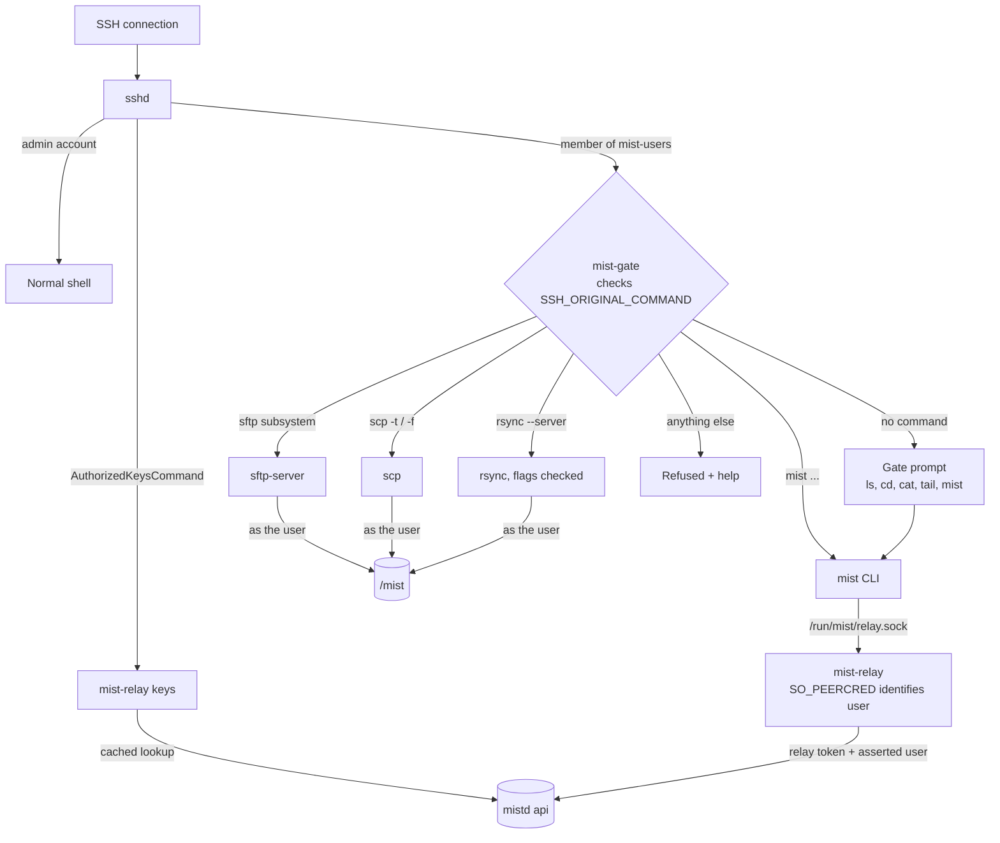
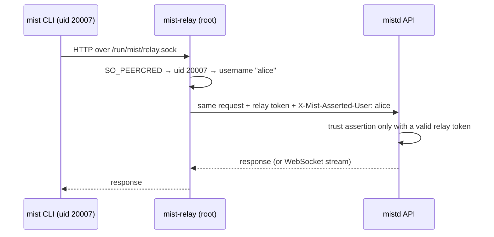

# Login gateway and CLI

Covers how researchers reach Mist over SSH, what they can do there, how their
identity reaches the API, and the `mist` command. Overview:
[ARCHITECTURE.md](../../../ARCHITECTURE.md). Related decisions: D6, D7, D11.

## Placement

- **Host:** the login gateway runs on the TT box, which also holds `/mist`
  volume 1. Uploads therefore write straight to local disk.
- **Access:** researchers reach it over Tailscale: `ssh <user>@100.95.175.37`,
  or later a friendly Tailscale name.
- **Admins** use separate admin accounts that are not in `mist-users`. They are
  not restricted (see [deployment-and-network.md](deployment-and-network.md)).

## How it fits

Every SSH connection is routed by account type, then by the command requested:



## sshd configuration

```text
PasswordAuthentication no
KbdInteractiveAuthentication no
PubkeyAuthentication yes
PermitUserEnvironment no
AuthorizedKeysCommand /usr/local/bin/mist-relay keys %u
AuthorizedKeysCommandUser mist-keys

Match Group mist-users
    AuthorizedKeysFile none
    PermitUserRC no
    ForceCommand /usr/local/bin/mist-gate
    AllowTcpForwarding no
    AllowAgentForwarding no
    AllowStreamLocalForwarding no
    PermitTunnel no
    X11Forwarding no
    PermitTTY yes
```

This is a configuration fragment, not a complete access-control installation.
Install a root-controlled SSH/PAM account/session check backed by the local
active/deny state and lease from Identity. Track and register each researcher
transport/session before it can run a command, and deny on missing/stale state.
Retain `mist-users` permanently. Keep the login home root-owned, use a fixed
admin-controlled shell, and disallow user startup hooks and environment injection
(including `LD_*`, `BASH_ENV`, `ENV`, and unsafe `AcceptEnv` entries). Verify the
effective configuration with `sshd -T -C` for active, disabled and admin accounts.
Admin access uses an explicit separate allowlist, independent of researcher leases.
`PermitUserEnvironment` is global (not valid inside Match); keep the installed
OpenSSH version's allowed Match directives in mind. Reference:
[sshd_config](https://man.openbsd.org/sshd_config).

Researcher sessions run inside a systemd slice (`mist-login.slice`) with a total
cap (for example 4 CPUs and 16 GiB) and a per-user process limit. Gateway work
is light, and the slice stops a runaway transfer from starving the host.

## `mist-gate`: what a session may do

`mist-gate` runs as the researcher. It inspects `SSH_ORIGINAL_COMMAND` and
either runs an allowed program or refuses:

| Request | Action |
|---|---|
| SFTP subsystem (also used by modern `scp`) | exec `sftp-server -u 0027` |
| Legacy `scp -t` / `scp -f` | exec `scp` with only those server-mode flags |
| `rsync --server ...` | validate flags as `rrsync` does (no remote shell or daemon options); exec `rsync` |
| `mist <args>` | exec the `mist` CLI |
| No command (plain `ssh`) | the **gate prompt** (below) |
| Anything else | refuse, with a short help message |

The **gate prompt** is a small built-in shell written in Go. It never starts a
real shell or arbitrary programs. It offers:

- `cd`, `ls`, `pwd`, `cat`, `head`, `tail [-f]`, `du -sh`, `rm`, `mv`, `mkdir`,
  each implemented in Go with the user's own permissions
- the full `mist` command set
- `help` and `exit`

A pager like `less` is not offered, because pagers can launch shells.

Set `umask 0027` before dispatch, use absolute executable paths and a sanitized
environment, and never pass the original command through a shell. Match parsed
argv against explicit allowlists, including rsync server flags. File operations
must be confined to the user's authorized team paths and login landing links;
Unix access to arbitrary host paths such as `/proc`, devices or runtime sockets
is not an allowed transfer capability. Implement and test confinement for each
external transfer server (a rooted filesystem view or equivalent audited
restriction), including symlink traversal and rename races. A command-name
allowlist alone is insufficient. Integrate transfer permissions with
[storage.md](storage.md#access-rules).

On login it prints a banner: team folders, a reminder of what is private (see
"What researchers see" in [storage.md](storage.md)), storage warnings, and
running jobs.

## Identity relay

The CLI on the gateway must call the API **as the researcher**, without a token
on disk. `mist-relay` handles that:



- **Placement:** the relay runs as root under systemd on the gateway host and
  listens on a Unix socket open to `mist-users`.
- **Who the caller is:** it reads the caller's UID from the kernel
  (`SO_PEERCRED`), never from the request. It strips any client-supplied
  `X-Mist-*` headers.
- **What it forwards:** only `/v1/...` user endpoints, never `/v1/admin/...` or
  `/internal/...`. It proxies WebSockets, for log follow and interactive attach.
- **The relay token is powerful,** since it can assert any user. It lives in
  `/etc/mist/relay.token` (0600 root) and is rotated if exposed.
- **SSH key lookup:** cached keys are usable only while the authorization lease
  is valid and the local applied generation matches. Deny entries override all
  caches. Never renew a lease from cached data. The root watchdog closes all SSH
  sessions for expired/revoked accounts, including SFTP, rsync and multiplexed
  connections. See [the revocation protocol](identity-and-accounts.md#revocation-and-provisioning-barrier-m1).
- **Socket authorization:** strip all client credentials before adding relay
  credentials, normalize the route once, and enforce the allowlist after
  normalization. Disabled accounts cannot use the relay even though they retain
  socket group membership. Key lookup is a separate operation from user proxying.

## The `mist` CLI

Job and option names follow Slurm, so instructions written for other clusters
translate easily.

| Command | Purpose |
|---|---|
| `mist submit [opts] script.sh [args]` | Submit a batch job (like `sbatch`). Prints the job ID. |
| `mist run [opts] -- <cmd...>` | Run a command as a job and stream its output until it ends (like `srun`). Ctrl-C cancels. |
| `mist shell [opts]` | Interactive job with a terminal (like `salloc` + `srun --pty`) |
| `mist attach <id>` | Reattach to an interactive job within its grace period |
| `mist jobs [--all-teams] [--state ...]` | Your jobs (like `squeue --me`) |
| `mist queue [-p partition]` | Partition queue view; other teams anonymised (D15) |
| `mist show <id> [--script]` | Full job record, pending reason, exit reason |
| `mist logs <id> [-f]` | Print or follow the job's output |
| `mist cancel <id...>` | Cancel jobs |
| `mist partitions` | Partitions, free capacity, limits |
| `mist usage` | Team storage and compute usage |
| `mist whoami` | Account, teams |

**Common options**, also accepted as `#MIST` lines at the top of a script:

```text
-p, --partition gpu|cpu|tt     --qos normal|interactive
--team <slug>                  default: team of the current folder
--gpus N   --tt-boards N       --cpus N   --mem 32G   --scratch 100G
-t, --time 4:00:00             --name <name>
--output <path>                default: mist-%j.out in the submit folder
--chdir <path>                 default: current folder
--env KEY=VALUE                repeatable; the login environment is NOT copied
--signal-grace 60s             time between SIGTERM and SIGKILL (1–120 s)
--runtime <profile-version>    approved retained profile for the partition
```

**Defaults the CLI fills in:**

- **Working directory:** the folder the command was run from. Inside the gate
  prompt that is the `cd` location; for `ssh host mist ...` it is the login
  landing folder.
- **Team:** send the canonical current path and an explicit team if supplied;
  the API derives/validates the charged team. Resolve landing-folder symlinks.
  Outside a team directory require `--team`; absent `--chdir`, the API then uses
  that team's personal home. Never submit `/mist/login/<user>` as a job workdir.

The CLI turns options into a job spec (see [api.md](api.md)), generates one
Idempotency-Key per submission and reuses it on transport retries through the
relay. A user-requested resubmit uses a new key. All checks happen in the API. The CLI only parses input and
displays results.

## Work by milestone

- **M1:**
  - sshd config, startup-hook hardening and transfer path confinement
  - root session tracking/watchdog, bounded leases and revocation acknowledgements
  - `mist-gate` with SFTP, scp, rsync and the gate prompt
  - `mist-relay` with key lookup
  - CLI: `submit`, `run`, `jobs`, `queue`, `show`, `logs`, `cancel`,
    `partitions`, `whoami`
- **M2:** `shell` and `attach` (terminal size, signals, reattach).
- **M3:** `usage`, and richer `queue` output.
- **Later:**
  - port forwarding into interactive jobs (`mist forward <id> 8888`, for Jupyter
    or TensorBoard)
  - a laptop CLI using personal API tokens

## Open questions

- Owner.
- A stable hostname: Tailscale MagicDNS name or an alias.
