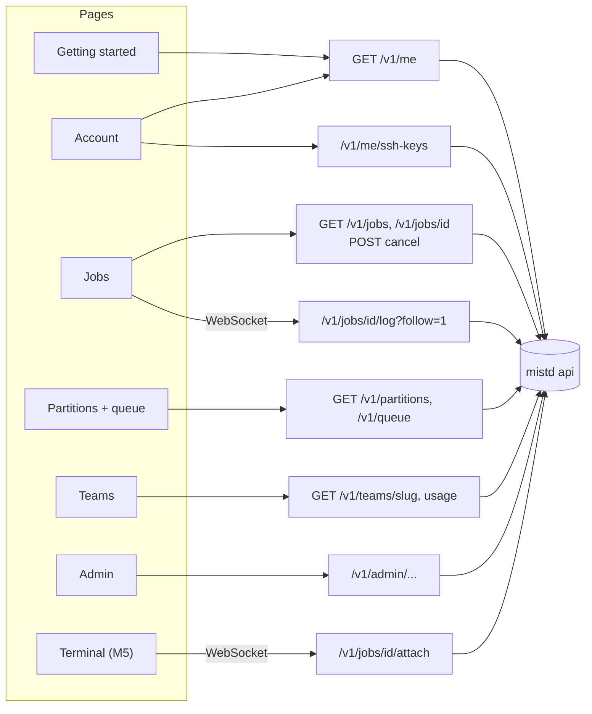

# Web portal

A lightweight browser UI over the API. It shows state and offers simple actions.
All logic (permissions, defaults, states, reasons) lives in the API. Overview:
[ARCHITECTURE.md](../../../ARCHITECTURE.md). API contract: [api.md](api.md).

## Principles

- **Display what the API says.** Fields like `pending_reason`, `pending_detail`,
  `can_cancel`, `can_attach` and usage summaries come ready to show. The portal
  doesn't recompute them.
- **Polling is fine.** Refresh job and queue views every 5–10 s while visible.
  Use WebSockets only for log follow, and for the terminal later.
- **Show the command-line equivalent** of each portal action where one exists,
  for example "`mist cancel 412`". Most work happens over SSH, and this helps
  people learn the CLI.
- **Unknown enum values show as plain text.** The API may add states or reasons.
- **Show actual completion.** `CLEANING` means work ended but resources are still
  held; `NODE_FAIL` with `cleanup_pending` means uncertain cleanup/quarantine.
  Display `output_incomplete` instead of promising a complete log. Revocation
  remains pending until gateway/executor acknowledgement; disabled is not proof
  a disconnected machine has stopped its old process.
- **No inferred privileges.** Honor server `can_cancel`/`can_attach`; handle
  rejected actions and expired sessions by refreshing state. Browser terminals
  are views of persistent shells; closing a tab detaches, explicit cancel stops.

## Pages

| Page | Content | Milestone |
|---|---|---|
| Sign in / sign up | Misty-registered check, username confirmation | M1 |
| Getting started | Your SSH command, login host, your team folders, and the "What researchers see" points from [storage.md](storage.md) and [runtime-environment.md](runtime-environment.md); a minimal job script example | M1 |
| Account | Username, UID, SSH keys (add, label, delete, last used) | M1 |
| Jobs | Your jobs, filterable by team and state; detail view with state history, pending/exit reason, resources, live or tail log, cancel | M1 |
| Partitions and queue | Free and total capacity per partition; queue with other teams anonymised | M1 |
| Teams | Membership, folder paths, storage usage per member, compute usage | M1 (storage), M3 (compute) |
| Admin | Accounts (disable or enable), partitions, QoS, limits, nodes (drain or up), provisioner status per host, volumes | M3 (M1: read-only node/provisioner/revocation/cleanup status; disable API already exists) |
| Terminal | Browser terminal attached to an interactive job | M5 |

Which endpoints each page uses:

## Not in the portal

- **Job submission.** Scripts live in `/mist` and are submitted over SSH. A
  "resubmit with changes" or "submit script at path" form could come after M3
  if people ask for it.
- **File browsing, upload and download.** Use `scp`, `rsync` or SFTP clients
  (for example WinSCP or Cyberduck). A read-only file viewer could come later.

## Work by milestone

- **M1:** sign-in, getting started, account, jobs, partitions and queue, team
  storage.
- **M3:** admin pages, compute usage and fairshare.
- **M5:** the terminal.
