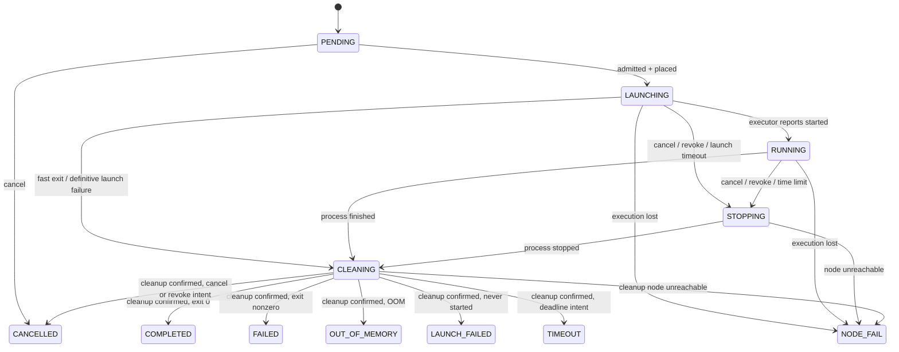
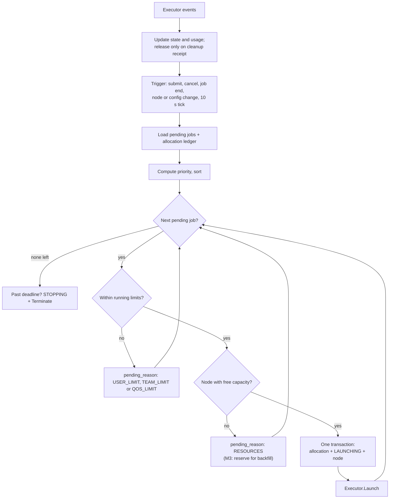

# Scheduler

Decides which job runs, when, and where. It owns partitions, QoS, limits,
priority, placement and accounting. It asks an executor to run admitted jobs
(see [executors.md](executors.md)). Overview:
[ARCHITECTURE.md](../../../ARCHITECTURE.md). Related decisions: D1, D3, D15, D17.

## Responsibilities

- Keep the queue and each job's state machine (the database is the source of
  truth).
- Apply partition, QoS, user and team limits, and explain every wait with a
  `pending_reason`.
- Order jobs by priority, and place each one on a node with free capacity.
- Enforce time limits and cancellations.
- Record usage for fairshare and accounting.
- Reconcile its records with what executors actually run.

## Partitions

A partition is a set of nodes with the same kind of hardware, served by one
executor. These are the proposed initial values; admins change them in the
database without a redeploy.

| | `gpu` | `cpu` | `tt` (M4) |
|---|---|---|---|
| Nodes | `utmist-z1opa08` | `utmist-tt` | `utmist-tt` |
| Executor | k3s | k3s | k3s |
| Accelerators | 2× RTX A4000 (16 GB) | none | 4× n300 boards |
| Kept for the host | 4 CPUs, 16 GiB | 8 CPUs, 64 GiB (NFS, login gateway) | shared with `cpu` |
| Partition-wide cap | node capacity | 16 CPUs, 192 GiB (leaves room for `tt`) | node capacity |
| Accelerators per job | 1–2 GPUs (≥ 1 required) | 0 | 1–4 boards |
| Default per accelerator | 8 CPUs, 32 GiB | — | 4 CPUs, 32 GiB |
| Max per accelerator | 26 CPUs, 70 GiB | — | 6 CPUs, 96 GiB |
| Default / max per job (CPU only) | — | 2 CPUs, 8 GiB / 16 CPUs, 128 GiB | — |
| Time limit default / max | 1 h / 24 h | 1 h / 24 h | 1 h / 24 h |
| Scratch default / max | 100 / 200 GiB | 50 / 500 GiB | 100 / 500 GiB |

- **Defaults scale with GPUs.** A job asking for `--gpus 2` without CPU or
  memory gets twice the per-GPU default.
- **Per-GPU maximums** make sure one job can't leave another GPU unusable (D17).
- **Partitions can share a node.** The scheduler tracks capacity per node, so
  jobs from `cpu` and `tt` on the same machine draw from the same pool.

## QoS

| QoS | Priority weight | Time limit | Other limits |
|---|---|---|---|
| `normal` | 0 | partition default and max | — |
| `interactive` | High: ahead of all `normal` jobs | default 1 h, max 4 h | At most 1 running interactive job per user per partition; at most 1 GPU or 1 board; reattach grace 10 min |

## Limits

Limits are database rows: `(scope, subject, partition, qos, resource, max)`.

- **Scope:** `user`, `team` or `partition`.
- **Subject:** a specific user or team, or `*` for everyone.

Within each scope/resource, choose an exact subject over `*`, then exact
partition over wildcard, then exact QoS over wildcard. Enforce the resulting
user, team and partition constraints together; a user override cannot bypass a
team cap. Reject duplicate keys. Count all unreleased allocations, including
launching/stopping/cleaning jobs, toward concurrent resource limits. Proposed
M1 defaults:

| Limit | Default |
|---|---|
| Running GPUs per user (`gpu`) | 1 |
| Running GPUs per team (`gpu`) | 2 |
| Running jobs per user (`cpu`) | 4 |
| Queued + running jobs per user (all partitions) | 50 |

With these limits, two people get one A4000 each. Admins can raise a person's
GPU limit, for example during an exam-free week, without code changes.

Some limits are checked at **submit** (job size within partition and QoS
maximums; queue length) and rejected with `limit_exceeded`. Limits on what is
**running** don't reject: the job waits with reason `USER_LIMIT` or
`TEAM_LIMIT`.

## Job states



- **Pending reasons** (shown to users):
  - `PRIORITY`: other jobs are ahead
  - `RESOURCES`: not enough free capacity
  - `USER_LIMIT`, `TEAM_LIMIT`, `QOS_LIMIT`
  - `PARTITION_DOWN`
  - `PROVISIONING`: required folders/identity generation not ready
  - `AUTH_UNAVAILABLE`: authorization freshness cannot be established
  - `HELD`: an admin hold
- **Exit reasons** add detail to the terminal states, for example "exceeded
  32 GiB memory limit", "time limit 4h reached", "cancelled by alice" or "node
  utmist-tt unreachable".
- **Every transition is written** to `job_events` (time, from, to, reason,
  actor). `mist show` and the portal display this history.
- **No automatic execution retries.** Repeat the same idempotent Launch call
  only to resolve an unstarted/ambiguous intent. A definitive launch failure or
  any execution that has started is never replaced automatically. A user resubmit
  creates a new job ID. This removes ambiguous retry/event identity semantics.
- **Outcomes:** store process result separately from job state and cleanup.
  `Finished` enters `CLEANING`; only cleanup acknowledgement releases allocations.
  `ScratchExceeded` maps to `FAILED` with that exit reason. Nonzero interactive
  shell exit also maps to `FAILED`. Fast jobs may finish before Started delivery;
  reconcile their actual start/finish times without requiring every watch event.
- **Cancellation races:** API persists a stop intent, never frees an allocation.
  Repeated cancellation returns the same job. The first committed stop cause
  (cancel, revoke, deadline) wins if no finish result is already committed;
  a later cancellation cannot relabel a finished job. A launch timeout before
  work starts yields `LAUNCH_FAILED`. Late events cannot reopen a terminal job.
- **Authorization:** stale unstarted admission generations are cancelled as
  specified by Identity; running jobs in still-authorized teams are not cancelled
  just because an unrelated membership changed.
- **Lost nodes:** after 2 min of confirmed unreachability, report `NODE_FAIL`
  with `cleanup_pending=true`, keep allocations quarantined and the node down.
  Do not retry lost work or reuse its devices until recovery/fencing proves the
  old execution stopped. Terminal state alone never releases capacity.

## Scheduling cycle

One active scheduler runs at a time. `mistd scheduler` holds a Postgres advisory
lock on a dedicated connection, and a second instance stays idle until the lock
frees. Database connection loss stops dispatch immediately. Use bounded external
calls, per-job serialization and persisted operation intent; a replacement leader
reconciles unresolved operations before admissions on affected nodes. An advisory
lock alone cannot fence an already in-flight Kubernetes request. Quarantine any
node whose old operations cannot yet be proven complete.

Database writes are fenced by a **leader epoch**. A new leader increments
`scheduler_cursors.leader_epoch`. Every scheduler transaction first share-locks
that row and aborts unless the epoch is still its own. A transaction an old
leader started on another pooled connection therefore cannot commit after a
takeover. API-side writes (submit, cancel) are not fenced; job row locks
serialize them with admission. An intent's status distinguishes `pending` (the
call was never sent, which proves nothing exists on the node) from `in_flight`
(ambiguous until observed).

A cycle runs on every event (submit, cancel, job end, node change, config
change), and also every 10 s:

1. Reconcile outstanding launch/stop/cleanup intents, then load pending jobs and
   all unreleased allocations across partitions sharing each node.
2. Compute each job's priority and sort.
3. For each job in order:
   1. Revalidate active account, team membership, authorization generation and
      provision readiness. Lock those records through Identity's package in the
      admission transaction. Then check concurrent limits and partition caps.
   2. Find a node in the partition with enough free CPU, memory, accelerators
      and scratch.
   3. If one fits: in **one transaction**, insert the allocation, move the job
      to `LAUNCHING` and set its node. Then call `Executor.Launch`. Launch
      requests use the immutable ExecutionID and SpecHash. Persist the full
      resolved LaunchSpec and admitted_at/launch_deadline with the allocation;
      later configuration changes cannot alter an admitted job's runtime or size.
      Lock/recheck job and capacity rows so concurrent cancel or config updates
      cannot invalidate the transaction. Call Kubernetes only after commit.
   4. If none fits: set `RESOURCES`. The backfill rule (M3) decides whether
      lower-priority jobs may still start.
4. At each `RUNNING` job's deadline (`started_at + time_limit`), move it to
   `STOPPING` and call `Executor.Terminate(grace)`.



**Free capacity** = the node's capacity reported by the executor, minus the
additional Mist host reserve, minus **all unreleased allocations**, including
`LAUNCHING`, `RUNNING`, `STOPPING`, `CLEANING` and quarantined terminal jobs.
Executor capacity is net of Kubernetes reservations; never deduct them twice.
The scheduler places jobs from this ledger and never waits for Kubernetes to tell
it whether something fits. Allocations record device IDs when reported (TT in
M4, all native devices in M5); otherwise they record
counts. Enforce the `cpu` partition-wide cap as well as the shared TT node
budget. Hugepages join this ledger in M4. Disk pressure and unhealthy resources
reduce effective capacity regardless of the nominal configured totals.

## Priority

- **M1:** QoS weight, then submit time (first in, first out within a QoS).
  Lower-priority jobs that fit may start when the top job doesn't fit. A
  2-GPU job can starve indefinitely under a continuous stream of 1-GPU jobs;
  short limits do not bound this wait. This is an explicit M1 limitation until
  M3 reservations ship. Do not advertise an estimated start as a guarantee.
- **M3, multifactor:**

  ```
  priority = W_qos · Q + W_fairshare · F + W_age · A
  Q = QoS factor in [0,1]
  A = min(wait_time / 3 days, 1)
  F = 2^(−U_team / S_team)
  ```

  - `U_team` is the team's decayed usage as a fraction of all usage, with a
    7-day half-life.
  - `S_team` is the team's share of the cluster, equal by default.
  - Proposed weights: `W_qos = 10000`, `W_fairshare = 5000`, `W_age = 1000`.
  - Admins can change the weights and the shares.

## Backfill (M3)

Every job has a time limit, so the scheduler can estimate when resources free
up.

1. Take the highest-priority job that doesn't fit, and find the earliest time
   `T` it could start, using deadlines plus signal grace and measured cleanup
   allowance. Consider only jobs eligible under authorization/limits. An unknown
   cleanup or launch completion time is not a promised future release.
2. Reserve the resources it will need at `T`.
3. A lower-priority job may start now only if it fits now **and** either ends
   before `T` or doesn't touch the reserved resources.

Keep the chosen reservation until admission, cancellation or an eligibility
change; recomputing it must not keep moving the same job behind new arrivals.
Recompute across shared-node partitions and include aggregate user/team caps.
This prevents starvation by lower-priority fitting jobs under healthy bounded
execution/cleanup. Strict interactive priority can still starve normal jobs
under sustained higher-priority demand; the simulator must report that separately.

## Interactive jobs

- **States:** an interactive job follows the same states as any other job. It
  becomes `RUNNING` once the executor reports its shell host ready.
- **Ending:** shell exit enters `CLEANING`, then `COMPLETED` for zero or `FAILED`
  for nonzero after cleanup.
- **Grace:** the executor's persistent PTY holder owns session state and the
  detach timer. If nobody attaches within 10 min of ready, or a disconnect lasts
  10 min, stop the job with reason "no terminal attached for 10 min". Persist
  observed attach/detach times for display; API process memory is not authority.
  Reattach resumes the same shell. Walltime continues while detached.

## Accounting

- **Billing units.** When a job ends, and every 15 minutes while it runs, the
  scheduler writes a usage record of resource-hours weighted into billing units.
  Proposed weights: 1 GPU-hour = 1.0, 1 TT-board-hour = 0.5,
  1 CPU-hour = 0.02. Admins can change them.
- **Used for:** fairshare, `mist usage`, and the portal's usage views.
- **Counted:** reserved resource time from admission through confirmed process
  finish, not utilization; a job holding an idle GPU pays for it. Track cleanup
  and quarantine occupancy separately so infrastructure failure is not billed
  indefinitely to a team. Use immutable per-job billing weights and nonoverlapping
  intervals with unique keys; restart/replayed completion cannot double-count.
  Retain raw timestamps/resources in M1 so M3 can derive accounting history.

## Reconciliation

The scheduler and the executor agree through events plus regular full
comparisons (see [executors.md](executors.md#cleanup-and-reconciliation)):

| Durable state | Authoritative observation | Action |
|---|---|---|
| `PENDING` | unexpected execution | Stop/quarantine it; do not adopt unauthorized work |
| `LAUNCHING`, no object/start receipt | no execution, proven no prior successful or unresolved create | Revalidate authorization and deadline; ensure the same execution exists |
| `LAUNCHING` | recorded object UID disappeared or possible unobserved start | Recover result receipt, otherwise report loss/quarantine; do not recreate |
| `LAUNCHING` | create outcome unknown / API unavailable | Retain allocation, retry observation; do not infer absence |
| `LAUNCHING` or `RUNNING` | running or finished execution | Adopt observed timestamps/result without rerunning; finish enters `CLEANING` |
| `RUNNING` | absent after successful fresh read and confirmation | Recover saved finish receipt, otherwise `NODE_FAIL`; quarantine unresolved cleanup |
| `STOPPING` | any live execution or unresolved launch | Reissue stop, resolve in-flight create, retain allocation |
| `CLEANING` | saved finish, cleanup incomplete | Resume cleanup; never relaunch |
| terminal | execution still exists | Stop/clean it; release only against matching cleanup receipt |
| any | failed/incomplete list | No absence inference; stop new admissions on affected nodes |

After restart, rebuild from persisted intent, receipts and a fresh full List;
wait for informer sync before using watches. Ignore stale object UIDs/events.
Unknown executions are stopped and accounted as quarantined occupancy until
cleanup. Reconcile control-plane recovery before marking a recovered node up.

## Nodes

`Executor.Nodes()` reports capacity, health and labels. Admins set a node's state
in the database:

- **`up`:** schedulable.
- **`drain`:** running jobs finish, but nothing new is placed there.
- **`down`:** not schedulable.

When the executor reports a node unhealthy, the scheduler treats it as `down`
until it recovers.

## API endpoints owned

| Endpoint | Purpose |
|---|---|
| `POST/GET /v1/jobs`, `GET /v1/jobs/{id}`, `POST /v1/jobs/{id}/cancel` | Job lifecycle |
| `GET /v1/partitions` | Partitions with live free capacity and limits |
| `GET /v1/queue` | Queue view; other teams anonymised |
| `/v1/admin/partitions`, `/v1/admin/qos`, `/v1/admin/limits`, `/v1/admin/nodes` | Admin configuration |
| `POST /v1/admin/jobs/{id}/hold`, `/release` | Admin holds |

## Database tables owned

`partitions`, `partition_nodes`, `nodes`, `qos`, `limits`, `jobs`, `job_specs`
(including the submitted script), `job_events`, `allocations`, `usage_records`,
`scheduler_settings`, durable operation intents and consumed-event IDs.
Executor-owned receipts are accessed through its package, not ad-hoc table reads.

## Work by milestone

- **M1:**
  - `gpu` and `cpu` partitions; `normal` QoS
  - limits, and FIFO within QoS
  - the allocation ledger and placement
  - time limits and cancellation
  - job states, pending and exit reasons, events
  - reconciliation, and the queue and partition views
- **M2:** `interactive` QoS and the attach grace lifecycle.
- **M3:** multifactor priority, fairshare, backfill, accounting records, admin
  configuration endpoints and holds.
- **M4:** the `tt` partition (board counts, board health from the executor).
- **M5:** device-level allocations for the native executor (TT board IDs already
  recorded in M4 for reset safety).

## Open questions

- Real default limits once actual usage is seen.
- Whether preemption is ever wanted, for example interactive jobs taking over
  long batch jobs. It is not planned.
- Opt-in GPU time-slicing for small debug jobs (D17).
