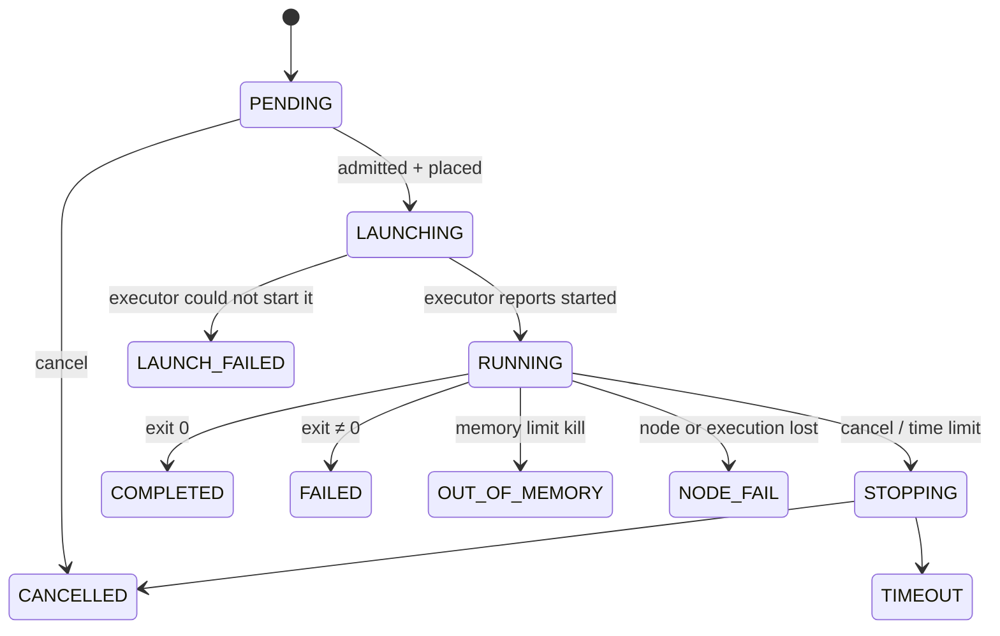

# Scheduler

Decides which job runs, when, and where. It owns partitions, QoS, limits,
priority, placement and accounting. It asks an executor to run admitted jobs
(see [executors.md](executors.md)). Overview:
[ARCHITECTURE.md](../../../ARCHITECTURE.md). Related decisions: D1, D3, D15, D17.

## Responsibilities

- Keep the queue and each job's state machine (the database is the source of
  truth).
- Apply partition, QoS, user and team limits, and explain every wait with a
  `pending_reason`.
- Order jobs by priority, and place each one on a node with free capacity.
- Enforce time limits and cancellations.
- Record usage for fairshare and accounting.
- Reconcile its records with what executors actually run.

## Partitions

A partition is a set of nodes with the same kind of hardware, served by one
executor. These are the proposed initial values; admins change them in the
database without a redeploy.

| | `gpu` | `cpu` | `tt` (M4) |
|---|---|---|---|
| Nodes | `utmist-z1opa08` | `utmist-tt` | `utmist-tt` |
| Executor | k3s | k3s | k3s |
| Accelerators | 2× RTX A4000 (16 GB) | none | 4× n300 boards |
| Kept for the host | 4 CPUs, 16 GiB | 8 CPUs, 64 GiB (NFS, login gateway) | shared with `cpu` |
| Partition-wide cap | node capacity | 16 CPUs, 192 GiB (leaves room for `tt`) | node capacity |
| Accelerators per job | 1–2 GPUs (≥ 1 required) | 0 | 1–4 boards |
| Default per accelerator | 8 CPUs, 32 GiB | — | 4 CPUs, 32 GiB |
| Max per accelerator | 26 CPUs, 70 GiB | — | 6 CPUs, 96 GiB |
| Default / max per job (CPU only) | — | 2 CPUs, 8 GiB / 16 CPUs, 128 GiB | — |
| Time limit default / max | 1 h / 24 h | 1 h / 24 h | 1 h / 24 h |
| Scratch default / max | 100 / 200 GiB | 50 / 500 GiB | 100 / 500 GiB |

- **Defaults scale with GPUs.** A job asking for `--gpus 2` without CPU or
  memory gets twice the per-GPU default.
- **Per-GPU maximums** make sure one job can't leave another GPU unusable (D17).
- **Partitions can share a node.** The scheduler tracks capacity per node, so
  jobs from `cpu` and `tt` on the same machine draw from the same pool.

## QoS

| QoS | Priority weight | Time limit | Other limits |
|---|---|---|---|
| `normal` | 0 | partition default and max | — |
| `interactive` | High: ahead of all `normal` jobs | default 1 h, max 4 h | At most 1 running interactive job per user per partition; at most 1 GPU or 1 board; reattach grace 10 min |

## Limits

Limits are database rows: `(scope, subject, partition, qos, resource, max)`.

- **Scope:** `user`, `team` or `partition`.
- **Subject:** a specific user or team, or `*` for everyone.

The most specific matching row wins. Proposed M1 defaults:

| Limit | Default |
|---|---|
| Running GPUs per user (`gpu`) | 1 |
| Running GPUs per team (`gpu`) | 2 |
| Running jobs per user (`cpu`) | 4 |
| Queued + running jobs per user (all partitions) | 50 |

With these limits, two people get one A4000 each. Admins can raise a person's
GPU limit, for example during an exam-free week, without code changes.

Some limits are checked at **submit** (job size within partition and QoS
maximums; queue length) and rejected with `limit_exceeded`. Limits on what is
**running** don't reject: the job waits with reason `USER_LIMIT` or
`TEAM_LIMIT`.

## Job states



- **Pending reasons** (shown to users):
  - `PRIORITY`: other jobs are ahead
  - `RESOURCES`: not enough free capacity
  - `USER_LIMIT`, `TEAM_LIMIT`, `QOS_LIMIT`
  - `PARTITION_DOWN`
  - `HELD`: an admin hold
- **Exit reasons** add detail to the terminal states, for example "exceeded
  32 GiB memory limit", "time limit 4h reached", "cancelled by alice" or "node
  utmist-tt unreachable".
- **Every transition is written** to `job_events` (time, from, to, reason,
  actor). `mist show` and the portal display this history.
- **No automatic retries.** A `LAUNCH_FAILED` caused by a transient executor
  error may be retried once before being reported.

## Scheduling cycle

One active scheduler runs at a time. `mistd scheduler` holds a Postgres advisory
lock, and a second instance stays idle until the lock frees.

A cycle runs on every event (submit, cancel, job end, node change, config
change), and also every 10 s:

1. Load the pending jobs of each partition, and the current allocations.
2. Compute each job's priority and sort.
3. For each job in order:
   1. Check the running limits. If one is hit, set the reason and move on.
   2. Find a node in the partition with enough free CPU, memory, accelerators
      and scratch.
   3. If one fits: in **one transaction**, insert the allocation, move the job
      to `LAUNCHING` and set its node. Then call `Executor.Launch`. Launch
      requests are safe to repeat (keyed by job ID).
   4. If none fits: set `RESOURCES`. The backfill rule (M3) decides whether
      lower-priority jobs may still start.
4. At each `RUNNING` job's deadline (`started_at + time_limit`), move it to
   `STOPPING` and call `Executor.Terminate(grace)`.

**Free capacity** = the node's capacity reported by the executor, minus the
host's reserved share, minus the allocations of all `LAUNCHING`, `RUNNING` and
`STOPPING` jobs. The scheduler places jobs from this ledger and never waits for
Kubernetes to tell it whether something fits. Allocations record device IDs when
an executor reports them (the native executor will); otherwise they record
counts.

## Priority

- **M1:** QoS weight, then submit time (first in, first out within a QoS).
  Lower-priority jobs that fit may start when the top job doesn't fit. A
  2-GPU job can therefore wait while 1-GPU jobs keep starting. Short default
  time limits keep that wait bounded until backfill arrives in M3.
- **M3, multifactor:**

  ```
  priority = W_qos · Q + W_fairshare · F + W_age · A
  Q = QoS factor in [0,1]
  A = min(wait_time / 3 days, 1)
  F = 2^(−U_team / S_team)
  ```

  - `U_team` is the team's decayed usage as a fraction of all usage, with a
    7-day half-life.
  - `S_team` is the team's share of the cluster, equal by default.
  - Proposed weights: `W_qos = 10000`, `W_fairshare = 5000`, `W_age = 1000`.
  - Admins can change the weights and the shares.

## Backfill (M3)

Every job has a time limit, so the scheduler can estimate when resources free
up.

1. Take the highest-priority job that doesn't fit, and find the earliest time
   `T` it could start, using the deadlines of running jobs.
2. Reserve the resources it will need at `T`.
3. A lower-priority job may start now only if it fits now **and** either ends
   before `T` or doesn't touch the reserved resources.

This removes M1's starvation of large jobs without wasting idle GPUs.

## Interactive jobs

- **States:** an interactive job follows the same states as any other job. It
  becomes `RUNNING` once the executor reports its shell host ready.
- **Ending:** when the shell exits, the job ends `COMPLETED` with the shell's
  exit code.
- **Grace:** the API tracks attach sessions. If no session has been attached for
  the grace period, whether after a disconnect or because nobody attached after
  start, the job is cancelled with reason "no terminal attached for 10 min".

## Accounting

- **Billing units.** When a job ends, and every 15 minutes while it runs, the
  scheduler writes a usage record of resource-hours weighted into billing units.
  Proposed weights: 1 GPU-hour = 1.0, 1 TT-board-hour = 0.5,
  1 CPU-hour = 0.02. Admins can change them.
- **Used for:** fairshare, `mist usage`, and the portal's usage views.
- **Counted:** allocated time, not used time. A job that holds a GPU idle pays
  for it.

## Reconciliation

The scheduler and the executor agree through events plus regular full
comparisons (see [executors.md](executors.md#reconciliation)):

- **A job the database marks running has no execution:** after a short
  confirmation window, it becomes `NODE_FAIL`.
- **An execution has no live job:** the executor terminates it.
- **After a restart,** `mistd scheduler` rebuilds from the database plus
  `Executor.List`, never from memory.

## Nodes

`Executor.Nodes()` reports capacity, health and labels. Admins set a node's state
in the database:

- **`up`:** schedulable.
- **`drain`:** running jobs finish, but nothing new is placed there.
- **`down`:** not schedulable.

When the executor reports a node unhealthy, the scheduler treats it as `down`
until it recovers.

## API endpoints owned

| Endpoint | Purpose |
|---|---|
| `POST/GET /v1/jobs`, `GET /v1/jobs/{id}`, `POST /v1/jobs/{id}/cancel` | Job lifecycle |
| `GET /v1/partitions` | Partitions with live free capacity and limits |
| `GET /v1/queue` | Queue view; other teams anonymised |
| `/v1/admin/partitions`, `/v1/admin/qos`, `/v1/admin/limits`, `/v1/admin/nodes` | Admin configuration |
| `POST /v1/admin/jobs/{id}/hold`, `/release` | Admin holds |

## Database tables owned

`partitions`, `partition_nodes`, `nodes`, `qos`, `limits`, `jobs`, `job_specs`
(including the submitted script), `job_events`, `allocations`, `usage_records`,
`scheduler_settings`.

## Work by milestone

- **M1:**
  - `gpu` and `cpu` partitions; `normal` QoS
  - limits, and FIFO within QoS
  - the allocation ledger and placement
  - time limits and cancellation
  - job states, pending and exit reasons, events
  - reconciliation, and the queue and partition views
- **M2:** `interactive` QoS and the attach grace lifecycle.
- **M3:** multifactor priority, fairshare, backfill, accounting records, admin
  configuration endpoints and holds.
- **M4:** the `tt` partition (board counts, board health from the executor).
- **M5:** device-level allocations for the native executor.

## Open questions

- Real default limits once actual usage is seen.
- Whether preemption is ever wanted, for example interactive jobs taking over
  long batch jobs. It is not planned.
- Opt-in GPU time-slicing for small debug jobs (D17).
