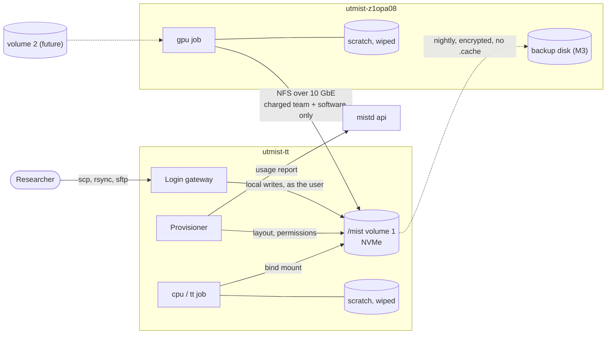

# Storage

Covers where files live, who can read and write them, how storage is served to
jobs, how it grows, and what researchers need to know. Overview:
[ARCHITECTURE.md](../../../ARCHITECTURE.md). Related decisions: D5, D8, D9, D10, D12.

## How it fits

Each path a byte can take to and from `/mist`:



## Two kinds of storage

| | **Durable: `/mist`** | **Scratch: node-local** |
|---|---|---|
| Holds | Code, environments, datasets, checkpoints, results, caches | Temporary files of a running job |
| Lifetime | Until deleted by a person | Deleted when the job ends |
| Visible from | Login gateway and every job (scoped to its team) | Only that job, on that node |
| Backed up | Yes (M3), except caches | Never |
| Path in jobs | `/mist/...` | `/scratch` (`$TMPDIR`) |

Anything worth keeping lives in `/mist`. Scratch exists only for speed.

## Layout

`/mist` is the same path on every host and inside every job.

```text
/mist/
├── teams/                          0711 root:root            names of other teams not listable
│   └── <team>/                     2750 root:team-<team>     other teams: no access
│       ├── <user>/                 2750 <user>:team-<team>   $HOME + default workdir; teammates read
│       │   ├── .cache/             0700 <user>               private: tool caches, HF token
│       │   ├── .config/            0700 <user>               private: wandb, gh, etc.
│       │   ├── .local/             0700 <user>               private
│       │   └── .ssh/               0700 <user>               private
│       ├── shared/                 2770 root:team-<team>     team-writable (default ACL g:rwX)
│       └── .cache/                 2770 root:team-<team>     team-shared HF / torch caches (default ACL g:rwX)
├── software/                       0755 root:root            shared read-only tools
├── login/                          0711 root:root
│   └── <user>/                     0750 root:<user>          login landing folder
│       └── <team> -> /mist/teams/<team>/<user>
└── .mist/                          0700 root:root            provisioner state, usage reports
```

The provisioner creates and repairs all of this (see
[identity-and-accounts.md](identity-and-accounts.md)). Every `/mist/teams/...`
path is derived from team slugs and usernames; nothing is chosen by researchers.

## Access rules

| Who | Own folder | Teammate's folder | Teammate's hidden folders | `shared/`, team `.cache/` | Another team |
|---|---|---|---|---|---|
| Owner | read/write | read | none | read/write | none |
| Team lead | read/write | read | none | read/write | none |
| Mist admin (root on hosts) | all | all | all | all | all |

- **Root can read everything.** Mist admins have root on the storage host, so
  they can read every file. IP agreements should state this.
- **Folders are scoped twice.** Unix permissions are the first wall. Job mounts
  are the second: a job is given only its charged team's folder (D5).
- **Permissions inherit.** Setgid folders give new files the team group. Inside
  jobs, `umask 0007` plus default ACLs on `shared/` and `.cache/` keep shared
  areas writable by the whole team.
- **Group count.** NFS `sec=sys` carries at most 16 groups per process. Jobs
  carry only `mist-users`, the charged team and the personal group, so the limit
  is never reached. The login gateway writes locally and doesn't use NFS.

## Serving `/mist`

- **Volume 1** is a folder on the TT box's NVMe (3.6 TB, about 1.9 TB free in
  October 2026). It is mounted at `/mist`.
- **NFS:** NFSv4.1+, exported only on the direct-link subnet `192.168.240.0/24`,
  with `rw,sync,root_squash,sec=sys,no_subtree_check`. It is never exported on
  the LAN or Tailscale.
- **Network:** a 10 GbE direct link (D10). Expect about 700–1000 MB/s for large
  sequential files.
- **The disk limits writes.** The Kingston NV2 is a budget NVMe drive: long
  writes slow down once its fast write buffer fills.
- **How jobs mount it:**
  - **On a remote node**, the executor mounts `<server>:<export>/teams/<team>` at
    `/mist/teams/<team>`, and `/mist/software` read-only.
  - **On the volume's own host** (TT box `cpu` and `tt` jobs), it uses local bind
    mounts, so there is no NFS loopback.

## Volumes and growth

A **volume** is one durable storage location: an export on one server. The
database holds:

| Field | Example |
|---|---|
| `id`, `name` | `1`, `tt-nvme` |
| `server_node`, `server_addr` | `utmist-tt`, `192.168.240.2` |
| `export_root` | `/mist` |
| `state` | `active`, `read-only`, `draining` |

Each team has exactly one `volume_id`, and a team folder is never split across
volumes.

- **Paths stay the same.** Researchers always see `/mist/teams/<team>` wherever
  the data physically lives. The executor and login gateway resolve the volume
  when they mount.
- **Adding storage:**
  1. Create the export.
  2. Add a volume record.
  3. Place new teams on it, or move a team during a maintenance window.
- **On the login gateway,** the provisioner mounts remote volumes' team folders
  at `/mist/teams/<team>` once there is more than one volume.
- **Spare disk goes elsewhere first.** Use it for backups, then scratch, and
  only then for a new volume.
- **No distributed filesystem.** Ceph, Gluster and JuiceFS are not worth running
  at this scale.

## Scratch

- **One folder per job,** on the node's local disk, mounted at `/scratch`, with
  `TMPDIR=/scratch`. It is deleted when the job ends, however it ends.
- **Size:** default limit 100 GiB per job, configurable per partition.
  Exceeding it ends the job, and the reason is shown.
- **Disks:**
  - **NVIDIA box:** prefer the second SSD (`sdb`, 447 GB) if it is confirmed
    unused; otherwise the root SSD.
  - **TT box:** local NVMe.
- **When it helps:** many small files, such as unpacking a tar of images. Large
  sequential reads and writes are fine on `/mist`.

## Usage and quotas

- **Reporting (M1).** The provisioner measures bytes per team and per member
  folder (including `shared/` and `.cache/`) on a schedule. It reports to the API
  without scanning NFS on each request. The portal shows usage; the login banner
  warns teams over their soft limit.
- **Limits are advisory** until hard quotas are possible. A full disk fails
  writes for everyone, so the portal and the gateway login banner warn early.
- **Hard quotas (open).** These need `/mist` on a dedicated filesystem with
  project quotas: XFS, or ext4 created with `-O quota,project`. Today `/mist`
  sits on the root partition. Converting is best done before data accumulates.

## Backups (M3)

- **Copy:** nightly, encrypted, deduplicated snapshot of `/mist`, stored on a
  disk in a **different machine** (the NVIDIA box's spare SSD to start).
- **Excluded:** every `.cache/` folder; their contents can be downloaded again.
- **Retention:** proposed 7 daily, 4 weekly and 3 monthly snapshots.
- **Restores are tested** each term. Backups that have never been restored
  don't count.
- **Encrypted** because the snapshots contain IP-bound work.

## What researchers see

This section is the source for user-facing documentation and login banners.

- **Your folder.** You have one folder per team, `/mist/teams/<team>/<you>`.
  When you log in, `~/<team>` takes you there. It is your home inside jobs for
  that team.
- **Visibility.** Teammates can **read** your folder; other teams can't see it
  exists.
- **Hidden folders are private.** `.cache`, `.config`, `.local` and `.ssh` in
  your folder are private to you. Tokens and logins saved by tools usually land
  there. Anything else in your folder is readable by teammates. Use
  `chmod 700 <folder>` to make something private.
- **Team areas.** `shared/` is writable by the whole team. The team `.cache/`
  holds Hugging Face and PyTorch downloads, so the team downloads each model
  once.
- **Scratch.** `$TMPDIR` (`/scratch`) is fast and temporary: it is deleted when
  your job ends, even if the job crashes or is cancelled. Never keep your only
  checkpoint there.
- **Limits.** Storage limits are shared per team and currently advisory. Please
  clean up, because a full disk stops everyone.
- **Admins.** Mist admins can technically read all files.

## Work by milestone

- **M1:**
  - volume 1 at `/mist` (ideally on a dedicated filesystem)
  - NFS export on the direct link
  - the layout and permissions above, with the provisioner
  - scratch on both nodes
  - usage reporting
- **M3:** backups, and quota enforcement if the filesystem allows it.
- **Later:** second volume, team moves between volumes, and a retention policy
  for departed members.

## Open questions

- Dedicated filesystem and hard quotas for `/mist`.
- Whether `sdb` on the NVIDIA box is free.
- Backup tool: restic or something else.
- Retention and offboarding policy.
