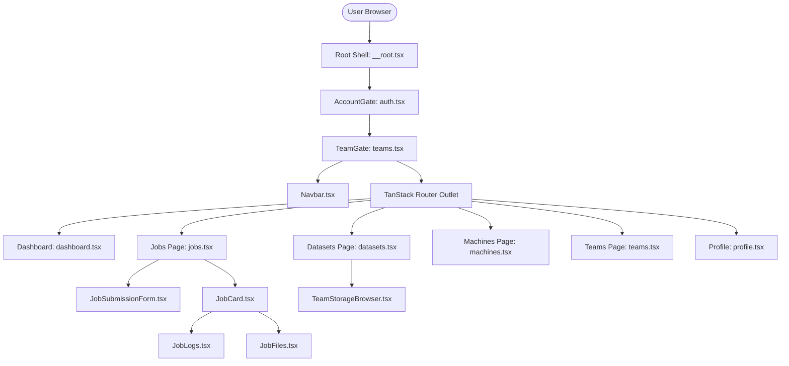

# Frontend Architecture & Backend Offloading

Documentation of the current Mist frontend ([`web-interface`](../../web-interface)), its structural organization, and a roadmap of client-side processing to offload to the backend.

## Architecture overview



### Technology stack

- **Vite 7.3**: Build tool and development proxy (`/api` and `/auth` forwards).
- **React 19.3**: Functional component architecture with custom hooks.
- **TanStack Router**: File-based routing located in `src/routes/` with code-splitting.
- **Tailwind CSS 4**: Modern styling via `@tailwindcss/vite` and customized Mist theme classes.
- **Better Auth Client**: Authentication state and admin member management.
- **Vitest 5 & Testing Library**: Unit and component tests.

### Source layout

| Location | Purpose |
|---|---|
| `src/main.tsx`, `router.tsx` | Router initialization and DOM hydration |
| `src/routes/__root.tsx` | Shell wrapper containing `AccountGate`, `TeamGate`, and `Navbar` |
| `src/routes/` | File-based routes (`dashboard.tsx`, `jobs.tsx`, `datasets.tsx`, `machines.tsx`, `teams.tsx`, `profile.tsx`) |
| `src/auth.tsx` | Better Auth client configuration, `AccountContext`, and `AccountGate` |
| `src/teams.tsx` | `TeamContext`, active team selection, workspace selector |
| `src/api.ts` | Typed HTTP client for jobs, datasets, hardware, and teams |
| `src/hooks/usePolling.ts` | In-flight request deduplication and abortable periodic polling |
| `src/components/jobs/` | `JobSubmissionForm`, `JobCard`, `JobLogs`, `JobFiles` |
| `src/components/` | `HardwarePanel`, `TeamStorageBrowser`, `Modal`, `Picker`, `Tabs`, `Card`, `Buttons` |

---

## Backend offloading plan

To keep the frontend as lightweight and simple as possible, the following responsibilities currently performed on the client should be handled by the backend:

1. **Pagination and filtering**:
   - `JobsPage`: Replace client-side slicing and array filtering with query parameters on `GET /jobs?status=...&q=...&page=...&limit=...`.
   - `DatasetsPage`: Add `GET /datasets?q=...`.
   - `AccountPage`: Replace Better Auth `listUsers({ limit: 1000 })` with a paginated endpoint `GET /members?page=...&q=...`.
2. **Metrics aggregation**:
   - Provide `GET /metrics/summary` or summary counters in list endpoints to avoid transferring full item arrays just to compute badge totals.
3. **Image catalog and validation**:
   - Move registry string parsing and image approval checks from `JobSubmissionForm` to server-side submission validation.
4. **Quota and limit calculation**:
   - Replace client-side calculation of `maxDevices` and `maxTimeout` with authoritative constraints provided by the team policy API.
5. **Form parsing**:
   - Accept raw multiline environment variable text and shell commands on `POST /jobs`, delegating parsing and validation to the server.
6. **Error status handling**:
   - Replace English error string matching (e.g. `isPreparing`) with typed machine-readable status fields (`{ status: "provisioning" }`).
7. **Permission flags**:
   - Return explicit capability booleans (`can_cancel`, `can_delete`, `can_manage`) on entities rather than parsing role strings on the client.
8. **Atomic operations**:
   - Consolidate multi-call client sequences (e.g. team creation + creator enrollment, password reset + session revocation) into atomic backend operations.
9. **Event-driven updates**:
   - Replace high-frequency polling with Server-Sent Events (SSE) or WebSockets for live job status and log streaming.

---

## Testing with the fake backend

A self-contained testing backend is provided in `scripts/fake-backend.mjs`. It simulates all Mist API endpoints and Better Auth handlers in memory.

### Running locally

```bash
# Terminal 1: Start fake backend (default port 3000)
npm --prefix web-interface run fake-backend
```

```bash
# Terminal 2: Start frontend dev server (port 3001)
npm --prefix web-interface run dev -- --host 127.0.0.1 --port 3001 --strictPort
```

Open http://127.0.0.1:3001 in your browser. Pre-seeded users include `ada@utmist.gitlab.io` (admin), `alan@utmist.gitlab.io`, and `grace@utmist.gitlab.io`.

### Configuring hypothetical scenarios and fake information

A companion configure tool is provided at `scripts/configure-fake-backend.mjs` to set up hypothetical cluster topologies, error conditions, and user setups:

```bash
# Interactive menu (choose scenarios, add fake nodes, switch active user)
npm --prefix web-interface run configure-fake-backend

# Switch to a preset scenario directly
node scripts/configure-fake-backend.mjs --scenario high-load
node scripts/configure-fake-backend.mjs --scenario unhealthy
node scripts/configure-fake-backend.mjs --scenario empty-slate
node scripts/configure-fake-backend.mjs --scenario large-cluster
node scripts/configure-fake-backend.mjs --scenario default

# Inspect current cluster topology & status
node scripts/configure-fake-backend.mjs --status

# Add custom fake machines, users, or teams
node scripts/configure-fake-backend.mjs --add-machine name=dgx-custom,ip=10.99.1.5,cpu=64,ram=256Gi,gpu=8
node scripts/configure-fake-backend.mjs --add-user name="Marie Curie",email=curie@rad.edu,role=admin
node scripts/configure-fake-backend.mjs --set-user curie@rad.edu
```

If the fake backend is running, `configure-fake-backend.mjs` updates the live server immediately without requiring a restart, while also saving to `.fake-backend-config.json` for persistence.

