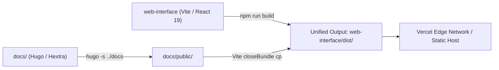

# Web interface and documentation deployment

Mist serves a unified static web footprint:
1. **Web portal**: A React 19 single-page application (SPA) built with Vite and TanStack Router, located in [`web-interface`](../../web-interface).
2. **Documentation site**: A static site built with Hugo and the Hextra theme, located in [`docs`](../../docs).

In production, both artifacts are compiled into a single output directory (`web-interface/dist`), where the web portal is served at `/` and the documentation site is served at `/docs/`.

---

## Unified build pipeline

The build pipeline combines the Vite application and Hugo documentation into one publishable distribution.



### Build prerequisites

- **Node.js & npm**: Node.js version 22.16.0 or newer with npm installed.
- **Hugo**: A standard Hugo (Extended) installation accessible in `PATH`.
- **Internet access**: Enabled during build for downloading npm dependencies and Hugo modules (such as Hextra).

### Local build execution

From the repository root:

```bash
npm --prefix web-interface ci
npm --prefix web-interface run typecheck
npm --prefix web-interface run build
```

Or from inside `web-interface`:

```bash
cd web-interface
npm ci
npm run typecheck
npm run build
```

The output is generated in `web-interface/dist`:
- `dist/index.html`: Web portal entrypoint and SPA assets in `dist/assets/`.
- `dist/docs/`: Hugo documentation static site with `dist/docs/index.html` and subpages.

---

## Deploying on Vercel

The repository includes preconfigured Vercel configuration files supporting either deployment mode.

### Option 1: Root directory set to `web-interface` (Recommended)

When connecting the GitHub repository to Vercel, set the **Root Directory** project setting to `web-interface`.

Vercel reads `web-interface/vercel.json`:

```json
{
  "$schema": "https://openapi.vercel.sh/vercel.json",
  "framework": "vite",
  "installCommand": "npm ci",
  "buildCommand": "npm run typecheck && npm run build",
  "outputDirectory": "dist",
  "redirects": [
    {
      "source": "/docs",
      "destination": "/docs/",
      "permanent": true
    }
  ],
  "rewrites": [
    {
      "source": "/((?!api(?:/|$)|auth(?:/|$)|docs(?:/|$)).*)",
      "destination": "/index.html"
    }
  ]
}
```

### Option 2: Root directory set to repository root (`.`)

When leaving **Root Directory** as default (`.`), Vercel reads the root `vercel.json`:

```json
{
  "$schema": "https://openapi.vercel.sh/vercel.json",
  "framework": "vite",
  "installCommand": "npm --prefix web-interface ci",
  "buildCommand": "npm --prefix web-interface run typecheck && npm --prefix web-interface run build",
  "outputDirectory": "web-interface/dist",
  "redirects": [
    {
      "source": "/docs",
      "destination": "/docs/",
      "permanent": true
    }
  ],
  "rewrites": [
    {
      "source": "/((?!api(?:/|$)|auth(?:/|$)|docs(?:/|$)).*)",
      "destination": "/index.html"
    }
  ]
}
```

### Routing and redirect behavior

1. **SPA Fallback Exclusion**: The rewrite regex `((?!api(?:/|$)|auth(?:/|$)|docs(?:/|$)).*)` routes client-side application paths (like `/jobs`, `/dashboard`, `/teams`) to `/index.html`. It explicitly excludes `/api`, `/auth`, and `/docs/`.
2. **Docs trailing slash redirect**: Hugo generates directory-based HTML structures (`docs/k3s-setup/index.html`). Requesting `/docs` is permanently redirected (HTTP 301) to `/docs/` to maintain relative asset resolution.
3. **Static docs serving**: Requests starting with `/docs/` resolve directly to files in `dist/docs/`.

---

## Backend connectivity

The frontend connects to the backend API (`/api`) and authentication endpoints (`/auth`).

### Environment variable `VITE_API_URL`

If the backend API is hosted on an external domain (e.g. `https://api.mist.example.com`), configure `VITE_API_URL` in the hosting provider's build environment:

```bash
VITE_API_URL="https://api.mist.example.com"
```

Vite inlines this variable into the compiled bundle during `npm run build`.

### Fallback connection screen

If the backend service is offline, unreachable, or in cold-start, the frontend displays an interactive connection error screen (`BackendConnectionError.tsx`) with a retry button and links directly to `/docs/` for operational troubleshooting.

---

## Switching to another hosting provider

To migrate from Vercel to another static hosting provider or container environment, adhere to the four platform requirements below.

### Platform requirements checklist

1. **Build environment**: The host must have Node.js (>= 22.16.0), npm, and Hugo installed, with network access to fetch npm dependencies and Hugo modules.
2. **Publish directory**: Point the publish directory to `web-interface/dist` (or `dist` if build root is `web-interface`).
3. **Docs path passthrough**: Requests to `/docs/*` must serve static files directly and must **not** be rewritten to `/index.html`.
4. **SPA routing fallback**: Unmatched routes (excluding `/api`, `/auth`, and `/docs`) must fall back to `/index.html` with HTTP status 200.
5. **Trailing slash on docs**: `/docs` must redirect to `/docs/`.

---

### Cloudflare Pages

1. **Project settings**:
   - Framework preset: `None`
   - Build command: `npm run build`
   - Build output directory: `dist`
   - Root directory: `web-interface`

2. **Redirects and routing (`web-interface/public/_redirects`)**:
   Create `_redirects` inside `web-interface/public/` (copied to `dist/` on build):

   ```text
   /docs    /docs/    301
   /docs/*  /docs/:splat  200
   /*       /index.html   200
   ```

---

### Netlify

Create `netlify.toml` in the repository root or `web-interface/`:

```toml
[build]
  base = "web-interface"
  publish = "dist"
  command = "npm run typecheck && npm run build"

[[redirects]]
  from = "/docs"
  to = "/docs/"
  status = 301
  force = true

[[redirects]]
  from = "/docs/*"
  to = "/docs/:splat"
  status = 200

[[redirects]]
  from = "/*"
  to = "/index.html"
  status = 200
```

---

### Self-hosted Nginx or Docker

A production Dockerfile builds both artifacts and serves them via Nginx:

```dockerfile
# Build stage
FROM node:22-alpine AS builder
RUN apk add --no-cache hugo git
WORKDIR /app
COPY . .
RUN cd web-interface && npm ci && npm run typecheck && npm run build

# Runtime stage
FROM nginx:alpine
COPY --from=builder /app/web-interface/dist /usr/share/nginx/html
COPY deploy/nginx-portal.conf /etc/nginx/conf.d/default.conf
EXPOSE 80
CMD ["nginx", "-g", "daemon off;"]
```

Corresponding Nginx configuration (`nginx-portal.conf`):

```nginx
server {
    listen 80;
    server_name _;
    root /usr/share/nginx/html;
    index index.html;

    # Canonical docs trailing slash
    location = /docs {
        return 301 /docs/;
    }

    # Static Hugo documentation
    location /docs/ {
        try_files $uri $uri/ =404;
    }

    # Backend API proxy
    location /api/ {
        proxy_pass http://mist-api:3000/;
        proxy_set_header Host $host;
        proxy_set_header X-Real-IP $remote_addr;
    }

    # Backend Auth proxy
    location /auth/ {
        proxy_pass http://mist-api:3000/auth/;
        proxy_set_header Host $host;
        proxy_set_header X-Real-IP $remote_addr;
    }

    # SPA history fallback
    location / {
        try_files $uri $uri/ /index.html;
    }
}
```

---

### AWS S3 + CloudFront

1. **S3 Bucket**: Upload the contents of `web-interface/dist` to an S3 bucket configured for static website hosting or Origin Access Control (OAC).
2. **CloudFront Behaviors**:
   - **Default (`*`)**: Points to S3 origin. Custom error response: HTTP 404/403 maps to `/index.html` with HTTP 200.
   - **Path Pattern `/docs/*`**: Points to S3 origin. Do not rewrite 404 to `/index.html`; allow standard S3 404 or Hugo 404.
   - **CloudFront Function / Lambda@Edge for `/docs`**: Redirects `/docs` to `/docs/` and appends `index.html` to directory subpaths.
